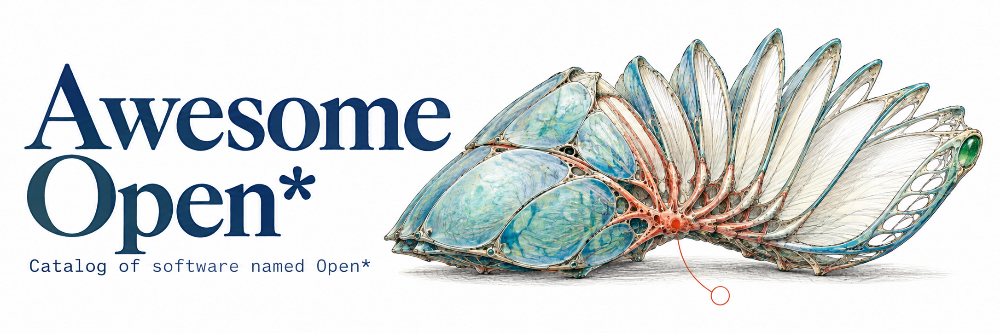

<!-- Generated by scripts/render_readme.py; edit README.source.md instead. -->

---  

- <b>Awesome Open*</b> - [Browse catalog](https://awesomeopen.github.io/awesome-open/)
- Best open alternatives to proprietary SaaS
- Open developer tools & local workflows
- Self-hosted AI infrastructure & automation

  
  

## Table of Contents

| | | |
| --- | --- | --- |
| <b>[AI & Language Models](#ai--language-models)</b> | <b>[Business & Commerce](#business--commerce)</b> | <b>[Maps & Geospatial](#maps--geospatial)</b> |
| <b>[Developer Tools](#developer-tools)</b> | <b>[Knowledge Management](#knowledge-management)</b> | <b>[Education & Research](#education--research)</b> |
| <b>[Infrastructure & DevOps](#infrastructure--devops)</b> | <b>[Communication & Social](#communication--social)</b> | <b>[Health & Medicine](#health--medicine)</b> |
| <b>[Databases & Search](#databases--search)</b> | <b>[Creative & Media](#creative--media)</b> | <b>[Operating Systems & Firmware](#operating-systems--firmware)</b> |
| <b>[Security & Privacy](#security--privacy)</b> | <b>[Games & Emulation](#games--emulation)</b> | <b>[Home Automation](#home-automation)</b> |
| <b>[Networking](#networking)</b> | <b>[Robotics & Hardware](#robotics--hardware)</b> | <b>[Finance & Trading](#finance--trading)</b> |
| <b>[Productivity & Office](#productivity--office)</b> | <b>[Science & Engineering](#science--engineering)</b> | <b>[Storage & File Management](#storage--file-management)</b> |

## AI & Language Models

| Project | Description |
| --- | --- |
| [OpenAgentCore](https://github.com/MiniMax-AI/OpenAgentCore) | Self-hosted implementation of the OpenAI Agents API with multiple agent harnesses. <!-- STATS:START --> 2026-09-21 -- 2026-10-21 / MIT / 240<!-- STATS:END --> |
| [open-annie](https://github.com/rehan-remade/open-annie) | Browser-based 3D character that combines spoken AI conversations with model-directed facial expressions and gestures. <!-- STATS:START --> 2026-10-07 -- 2026-10-07 / Apache-2.0 / 44<!-- STATS:END --> |
| [OpenArchEvo](https://github.com/Optima-CityU/OpenArchEvo) | Neural architecture search framework that combines LLM-written model programs with population-based evolution. <!-- STATS:START --> 2026-10-10 -- 2026-10-10 / Apache-2.0 / 46<!-- STATS:END --> |
| [OpenAssistant](https://github.com/LAION-AI/Open-Assistant) | Chat assistant that handles tasks, interacts with external systems, and retrieves information. <!-- STATS:START --> 2022-12-13 -- <b>2024-08-17</b> / Apache-2.0 / 37.4k<!-- STATS:END --> |
| [OpenAttention](https://github.com/hyunwoo137/OpenAttention) | Sparse-attention implementation that combines selected key-value tokens with cluster proxies during language-model inference. <!-- STATS:START --> 2026-10-11 -- 2026-10-12 / Apache-2.0 / 7<!-- STATS:END --> |
| [Open-AutoGLM](https://github.com/zai-org/Open-AutoGLM) | AI models and framework for phone automation. <!-- STATS:START --> 2025-12-08 -- 2026-03-06 / Apache-2.0 / 26.4k<!-- STATS:END --> |
| [OpenBot](https://github.com/regnull/openbot) | Self-hosted platform for persistent AI bots with shared conversations, tools, memory, and workflows. <!-- STATS:START --> 2026-09-13 -- 2026-10-19 / MIT / 31<!-- STATS:END --> |
| [Open Canvas](https://github.com/langchain-ai/open-canvas) | Web application for writing documents and editing code collaboratively with AI agents. <!-- STATS:START --> 2024-10-03 -- 2026-02-25 / MIT / 5.5k<!-- STATS:END --> |
| [OpenCharm](https://github.com/opencharm-labs/opencharm) | macOS desktop companion for AI agents with animated status faces, push-to-talk input, and spoken replies. <!-- STATS:START --> 2026-10-02 -- 2026-10-19 / MIT / 16<!-- STATS:END --> |
| [OpenChat](https://github.com/imoneoi/openchat) | Language-model library with fine-tuning and serving tools for models trained on mixed-quality data. <!-- STATS:START --> 2023-05-25 -- <b>2024-09-13</b> / Apache-2.0 / 5.5k<!-- STATS:END --> |
| [OpenClaude Desktop](https://github.com/oleyyu/OpenClaudeDesktop) | macOS coding-assistant application with configurable model providers, project sessions, file editing, terminal access, and change previews. <!-- STATS:START --> 2026-10-03 -- 2026-10-19 / 225<!-- STATS:END --> |
| **[OpenClaw](https://github.com/openclaw/openclaw)** <!-- HN:START --><!-- HN:END --> | Personal AI assistant that runs on your devices and connects to messaging apps. <!-- STATS:START --> 2025-11-24 -- 2026-10-21 / MIT / 392.7k<!-- STATS:END --> |
| [OpenCLIP](https://github.com/mlfoundations/open_clip) | Implementation of CLIP for learning image and text representations. <!-- STATS:START --> 2021-07-28 -- 2026-09-30 / 14.2k<!-- STATS:END --> |
| **[OpenCode](https://github.com/anomalyco/opencode)** <!-- HN:START --><!-- HN:END --> | AI coding agent for the terminal. <!-- STATS:START --> 2025-04-30 -- 2026-10-21 / MIT / 219.1k<!-- STATS:END --> |
| [OpenCompass](https://github.com/open-compass/opencompass) | Language-model evaluation across knowledge, reasoning, coding, and other tasks. <!-- STATS:START --> 2023-06-15 -- 2026-10-20 / Apache-2.0 / 7.5k<!-- STATS:END --> |
| [OpenComputer](https://github.com/andykr1k/OpenComputer) | Desktop AI agent that uses screenshots and local or hosted vision-language models to control applications. <!-- STATS:START --> 2026-07-22 -- 2026-10-01 / MIT / 19<!-- STATS:END --> |
| [OpenComputerUse](https://github.com/IAmJSD/OpenComputerUse) | MCP server for background desktop-app automation with screenshots, accessibility tools, and managed sessions. <!-- STATS:START --> 2026-10-07 -- 2026-10-20 / MIT / 15<!-- STATS:END --> |
| [open-cot](https://github.com/minimAluminiumalism/open-CoT) | Research scripts for eliciting and evaluating reasoning text from language-model APIs. <!-- STATS:START --> 2026-10-09 -- 2026-10-10 / MIT / 103<!-- STATS:END --> |
| [OpenCV](https://github.com/opencv/opencv) | Computer vision library. <!-- STATS:START --> 2012-07-19 -- 2026-10-21 / Apache-2.0 / 91.3k<!-- STATS:END --> |
| [Open Deep Research](https://github.com/langchain-ai/open_deep_research) | Configurable research agent supporting multiple model providers, search tools, and MCP servers. <!-- STATS:START --> 2024-11-20 -- 2026-08-10 / MIT / 12.7k<!-- STATS:END --> |
| [Open Dot](https://github.com/composio-community/open-dot) | Mac application for persistent personal AI agents with browsers, app integrations, and scheduled tasks. <!-- STATS:START --> 2026-09-29 -- 2026-09-30 / 670<!-- STATS:END --> |
| [OpenDots](https://github.com/CopilotKit/OpenDots) | Self-hostable template for persistent AI agents with individual computers, document workspaces, text, calls, and Slack. <!-- STATS:START --> 2026-09-29 -- 2026-10-15 / MIT / 5.7k<!-- STATS:END --> |
| [OpenFace](https://github.com/cmusatyalab/openface) | Face recognition with deep neural networks. <!-- STATS:START --> 2015-09-16 -- 2026-10-14 / Apache-2.0 / 15.4k<!-- STATS:END --> |
| [OpenFang](https://github.com/RightNow-AI/openfang) | Rust runtime for autonomous AI agents with scheduled tasks, persistent memory, messaging integrations, and a web dashboard. <!-- STATS:START --> 2026-02-24 -- 2026-07-02 / Apache-2.0 / 18.2k<!-- STATS:END --> |
| [OpenFeed](https://github.com/noemauser/OpenFeed) | Python library and command-line tools for exchanging searchable knowledge packs and messages among AI agents. <!-- STATS:START --> 2026-10-11 -- 2026-10-12 / MIT / 0<!-- STATS:END --> |
| [OpenFoundry](https://github.com/bsamud/openfoundry-agentic-framework) | AI-agent orchestration framework with DAG workflows, model routing, guardrails, and observability. <!-- STATS:START --> 2026-01-09 -- 2026-03-28 / MIT / 33<!-- STATS:END --> |
| [OpenFox](https://github.com/co-l/openfox) | Coding assistant for local language models with planning, implementation, and verification workflows. <!-- STATS:START --> 2026-03-11 -- 2026-10-05 / 363<!-- STATS:END --> |
| [Opengeni](https://github.com/Cloudgeni-ai/opengeni) | Service for running AI agents with durable sessions, replayable histories, human approvals, and managed execution environments. <!-- STATS:START --> 2026-04-16 -- 2026-10-21 / Apache-2.0 / 204<!-- STATS:END --> |
| [OpenGym](https://github.com/widingmarcus-cyber/opengym) | Benchmark for evaluating AI-agent coding, memory, tool use, planning, resilience, safety, and coordination. <!-- STATS:START --> 2026-03-01 -- 2026-03-14 / MIT / 1<!-- STATS:END --> |
| [OpenHands](https://github.com/OpenHands/OpenHands) <!-- HN:START --><!-- HN:END --> | AI agents for software development. <!-- STATS:START --> 2024-03-13 -- 2026-10-21 / MIT / 91.4k<!-- STATS:END --> |
| [OpenHuman](https://github.com/tinyhumansai/openhuman) | AI agent harness with local-first memory, agent orchestration, and workflows. Alternative to: [Vellum](https://www.vellum.ai/blog/best-openhuman-alternatives), [Hermes Agent](https://github.com/tinyhumansai/openhuman#how-it-compares), [OpenClaw](https://github.com/tinyhumansai/openhuman#how-it-compares) <!-- STATS:START --> 2026-02-18 -- 2026-10-21 / GPL-3.0 / 42.2k<!-- STATS:END --> |
| [Open Instinct](https://github.com/mariagorskikh/open-instinct) | Personal AI agent with its own computer, messaging integrations, and coordination with trusted contacts' agents. <!-- STATS:START --> 2026-10-03 -- 2026-10-21 / MIT / 376<!-- STATS:END --> |
| [Open Intelligent UI](https://github.com/thesysdev/open-intelligent-ui) | Demo application that turns AI chat requests into interactive maps, photos, and editable travel itineraries. <!-- STATS:START --> 2026-10-08 -- 2026-10-17 / MIT / 737<!-- STATS:END --> |
| [Open Interpreter](https://github.com/openinterpreter/openinterpreter) | Coding agent for running open language models. Alternative to: [Codex](https://www.openinterpreter.com/docs/terminal/migrate) <!-- STATS:START --> 2023-07-14 -- 2026-10-11 / Apache-2.0 / 68.6k<!-- STATS:END --> |
| [OpenJarvis](https://github.com/open-jarvis/OpenJarvis) | Framework for building and evaluating local-first personal AI agents. <!-- STATS:START --> 2026-02-15 -- 2026-10-20 / Apache-2.0 / 11.7k<!-- STATS:END --> |
| [OpenLLaMA](https://github.com/openlm-research/open_llama) | LLaMA reproduction with pretrained 3B, 7B, and 13B language-model weights for PyTorch and JAX. <!-- STATS:START --> 2023-04-28 -- <b>2023-07-16</b> / Apache-2.0 / 7.5k<!-- STATS:END --> |
| [OpenLLM](https://github.com/bentoml/OpenLLM) | Serve language models through OpenAI-compatible API endpoints. <!-- STATS:START --> 2023-04-19 -- 2026-10-20 / Apache-2.0 / 12.6k<!-- STATS:END --> |
| [Open-LLM-VTuber](https://github.com/Open-LLM-VTuber/Open-LLM-VTuber) | AI companion with voice conversations, visual input, and Live2D avatars, supporting local and hosted language and speech models. <!-- STATS:START --> 2023-11-24 -- 2026-05-15 / 14.2k<!-- STATS:END --> |
| [OpenLumara](https://github.com/Rose22/openlumara) | Local-first Python AI agent framework with modular tools, memory, scheduling, and browser, terminal, and messaging interfaces. <!-- STATS:START --> 2026-02-27 -- 2026-10-14 / GPL-3.0 / 517<!-- STATS:END --> |
| [OpenManus](https://github.com/FoundationAgents/OpenManus) | General-purpose AI agent with browser automation and tool support. <!-- STATS:START --> 2025-03-06 -- 2026-09-30 / MIT / 58.8k<!-- STATS:END --> |
| [openmoss-ggml](https://github.com/pwilkin/openmoss) | C++ and GGML runtime for MOSS speech and sound-effect models, with command-line synthesis, an HTTP server, and a web interface. <!-- STATS:START --> 2026-05-15 -- 2026-09-24 / Apache-2.0 / 75<!-- STATS:END --> |
| [OpenMuse](https://github.com/CopilotKit/openmuse) | Personal-agent application with a persistent browser, terminal, files, and background tasks. <!-- STATS:START --> 2026-09-15 -- 2026-10-21 / MIT / 5.4k<!-- STATS:END --> |
| [OpenMyMemo](https://github.com/MyMemoAI/openmymemo) | Local Markdown memory store shared by AI apps through MCP, with a review panel, change history, and undo. <!-- STATS:START --> 2026-10-11 -- 2026-10-21 / Apache-2.0 / 10<!-- STATS:END --> |
| [OpenNLP](https://github.com/apache/opennlp) | Java toolkit for natural language processing. <!-- STATS:START --> 2011-11-09 -- 2026-10-19 / Apache-2.0 / 1.6k<!-- STATS:END --> |
| [OpenNMT](https://github.com/OpenNMT/OpenNMT-py) | Neural machine translation and language modeling in PyTorch. <!-- STATS:START --> 2017-02-22 -- <b>2025-10-14</b> / MIT / 7k<!-- STATS:END --> |
| [Open Notebook](https://github.com/lfnovo/open-notebook) | NotebookLM-style research notebook with flexible model support. Alternative to: [NotebookLM](https://github.com/lfnovo/open-notebook#open-notebook) <!-- STATS:START --> 2024-10-21 -- 2026-10-20 / MIT / 40.4k<!-- STATS:END --> |
| [OPEN-OMNIVOICE-TTS](https://github.com/hypersniper05/open-omnivoice-tts) | Self-hosted text-to-speech server with voice cloning and an OpenAI-compatible API built on OmniVoice. <!-- STATS:START --> 2026-10-08 -- 2026-10-12 / MIT / 6<!-- STATS:END --> |
| [OpenOpen](https://github.com/thesongzhu/OpenOpen) | macOS personal AI agent with guided task planning and explicit confirmation of actions. <!-- STATS:START --> 2026-07-14 -- 2026-07-22 / MIT / 1<!-- STATS:END --> |
| [OpenPilot](https://github.com/ibmshaikh/OpenPilot) | Desktop AI agent with configurable model providers, file and terminal tools, web research, MCP integrations, skills, and memory. <!-- STATS:START --> 2026-07-27 -- 2026-10-18 / MIT / 19<!-- STATS:END --> |
| [OpenPipe](https://github.com/OpenPipe/OpenPipe) | Platform for fine-tuning, hosting, and evaluating language models using recorded prompts and datasets. <!-- STATS:START --> 2023-06-20 -- <b>2024-05-25</b> / Apache-2.0 / 2.8k<!-- STATS:END --> |
| [OpenPort](https://github.com/Joseph-B22/OpenPort) | Local Windows AI assistant for IT troubleshooting, with PowerShell command checks, file comparisons, and machine-state checks. <!-- STATS:START --> 2026-10-09 -- 2026-10-10 / Apache-2.0 / 0<!-- STATS:END --> |
| [OpenPose](https://github.com/CMU-Perceptual-Computing-Lab/openpose) | Real-time detection of body, face, hand, and foot keypoints. <!-- STATS:START --> 2017-04-24 -- <b>2024-08-03</b> / 34.5k<!-- STATS:END --> |
| [Open R1](https://github.com/huggingface/open-r1) | Training, evaluation, and synthetic-data generation scripts for reproducing DeepSeek-R1-style reasoning models. <!-- STATS:START --> 2025-01-24 -- 2026-10-02 / Apache-2.0 / 26.5k<!-- STATS:END --> |
| [Open-RAG](https://github.com/ShayekhBinIslam/openrag) | Training and inference code for retrieval-augmented language models with multi-hop question answering. <!-- STATS:START --> 2024-08-09 -- <b>2025-02-20</b> / CC-BY-4.0 / 145<!-- STATS:END --> |
| [OpenRLHF](https://github.com/OpenRLHF/OpenRLHF) | Scalable framework for reinforcement learning with language models. <!-- STATS:START --> 2023-07-30 -- 2026-10-05 / Apache-2.0 / 10.1k<!-- STATS:END --> |
| [OpenRouter](https://openrouter.ai/docs/quickstart) | Unified API for accessing language models from multiple providers. |
| [OpenSandbox](https://github.com/opensandbox-group/OpenSandbox) | Sandbox runtime for AI agents. <!-- STATS:START --> 2025-12-17 -- 2026-10-21 / Apache-2.0 / 16k<!-- STATS:END --> |
| [OpenSLA](https://github.com/yang-ai-lab/OpenSLA) | Sensor-language-action models that predict structured actions and describe sensor states from signals and text. <!-- STATS:START --> 2026-10-07 -- 2026-10-07 / MIT / 44<!-- STATS:END --> |
| [Open-Sora](https://github.com/hpcaitech/Open-Sora) | Models and tooling for video generation. <!-- STATS:START --> 2024-02-20 -- 2026-04-09 / Apache-2.0 / 29.9k<!-- STATS:END --> |
| [OpenSpiel](https://github.com/google-deepmind/open_spiel) | Game environments and algorithms for reinforcement-learning, search, and multi-agent research. <!-- STATS:START --> 2019-07-22 -- 2026-10-20 / Apache-2.0 / 5.5k<!-- STATS:END --> |
| [OpenSwarm](https://github.com/openswarm-ai/openswarm) | Desktop workspace for coordinating multiple AI agents with their own browsers, apps, and tools on a shared canvas. <!-- STATS:START --> 2026-03-13 -- 2026-10-11 / 829<!-- STATS:END --> |
| [OpenUI](https://github.com/wandb/openui) | Generate and preview user interfaces from natural-language descriptions. <!-- STATS:START --> 2024-03-17 -- 2026-10-16 / Apache-2.0 / 22.6k<!-- STATS:END --> |
| [OpenViking](https://github.com/volcengine/OpenViking) | Context database for agent memory, knowledge, and skills. <!-- STATS:START --> 2026-01-05 -- 2026-10-21 / AGPL-3.0 / 40.5k<!-- STATS:END --> |
| [OpenVINO](https://github.com/openvinotoolkit/openvino) | Toolkit for optimizing and deploying AI inference. <!-- STATS:START --> 2018-10-15 -- 2026-10-21 / Apache-2.0 / 11k<!-- STATS:END --> |
| [OpenVoice](https://github.com/myshell-ai/OpenVoice) | Instant voice cloning and audio foundation model. <!-- STATS:START --> 2023-11-29 -- <b>2025-04-19</b> / MIT / 38k<!-- STATS:END --> |
| [openWakeWord](https://github.com/dscripka/openWakeWord) | Wake-word detection library with pretrained models for voice-enabled applications. <!-- STATS:START --> 2022-05-28 -- 2025-12-30 / Apache-2.0 / 2.9k<!-- STATS:END --> |
| [OpenWants](https://openwants.com/) | Shared directory and messaging service where AI agents post needs and offers, find matches, and contact one another. |
| **[Open WebUI](https://github.com/open-webui/open-webui)** <!-- HN:START --><!-- HN:END --> | Web interface for AI models, including Ollama and OpenAI-compatible APIs. <!-- STATS:START --> 2023-10-06 -- 2026-10-21 / 156.3k<!-- STATS:END --> |

## Developer Tools

| Project | Description |
| --- | --- |
| [openalias](https://github.com/cypherstack/openalias) | Dart library for parsing OpenAlias records and resolving recipients with locally validated DNSSEC. <!-- STATS:START --> 2026-10-09 -- 2026-10-17 / MIT / 0<!-- STATS:END --> |
| [OpenAPI Generator](https://github.com/OpenAPITools/openapi-generator) | Generate client libraries, server stubs, and documentation from OpenAPI specifications. <!-- STATS:START --> 2018-05-12 -- 2026-10-21 / Apache-2.0 / 26.8k<!-- STATS:END --> |
| [OpenAPI TypeScript](https://github.com/openapi-ts/openapi-typescript) | Generate TypeScript types from OpenAPI 3 specifications. <!-- STATS:START --> 2018-12-13 -- 2026-09-25 / MIT / 8.4k<!-- STATS:END --> |
| [OpenBarcode](https://github.com/InPoint-Cloud/OpenBarcode) | .NET library and command-line tool for reading barcodes from images and PDFs using managed code. <!-- STATS:START --> 2026-10-10 -- 2026-10-11 / Apache-2.0 / 0<!-- STATS:END --> |
| [open-bridge](https://github.com/bks-lab/open-bridge) | Git-backed workspace of context, tasks, and skills used by coding-agent command-line tools. <!-- STATS:START --> 2026-06-20 -- 2026-10-20 / MIT / 13<!-- STATS:END --> |
| [OpenChamber](https://github.com/openchamber/openchamber) | Desktop, web, mobile, and VS Code workspace for running and reviewing AI coding sessions powered by OpenCode. <!-- STATS:START --> 2025-09-11 -- 2026-10-20 / MIT / 12k<!-- STATS:END --> |
| [OpenCLI](https://github.com/jackwener/OpenCLI) | Turn websites into command-line tools using an authenticated browser. <!-- STATS:START --> 2026-03-14 -- 2026-10-20 / Apache-2.0 / 30.5k<!-- STATS:END --> |
| **[OpenCode](https://github.com/anomalyco/opencode)** <!-- HN:START --><!-- HN:END --> | AI coding agent for the terminal. <!-- STATS:START --> 2025-04-30 -- 2026-10-21 / MIT / 219.1k<!-- STATS:END --> |
| [Open Codex](https://github.com/codingmoh/open-codex) | Terminal AI assistant that generates shell commands from natural-language requests using local models and Ollama. <!-- STATS:START --> 2025-03-29 -- 2026-10-20 / MIT / 695<!-- STATS:END --> |
| [Open Components](https://github.com/uxfront-com/open-components) | MCP server and reference implementations for building and reviewing UI components against documented rules and contracts. <!-- STATS:START --> 2026-09-26 -- 2026-10-20 / MIT / 11<!-- STATS:END --> |
| [OpenContextEngine](https://github.com/AnnaSuSu/OpenContextEngine) | Self-hostable code-search engine that supplies AI agents with source snippets through MCP using semantic, keyword, and code-relationship search. <!-- STATS:START --> 2026-10-02 -- 2026-10-12 / MIT / 51<!-- STATS:END --> |
| [OpenCover](https://github.com/OpenCover/opencover) | Code coverage tool for .NET on Windows. <!-- STATS:START --> 2011-02-22 -- <b>2021-11-15</b> / 1.3k<!-- STATS:END --> |
| [Open Design Agent Kit](https://github.com/feimacode/open-design-agent-kit) | Extensions and MCP tools that add UI design workflows, templates, and design systems to coding agents. <!-- STATS:START --> 2026-09-19 -- 2026-10-21 / MIT / 4<!-- STATS:END --> |
| [OpenDex](https://github.com/dogmastr/OpenDex) | Roblox explorer and script-analysis suite with Luau navigation, flowcharts, and runtime inspection. <!-- STATS:START --> 2026-10-07 -- 2026-10-11 / MIT / 18<!-- STATS:END --> |
| [OpenDocRouter](https://www.opendocrouter.ai/) | Unified document-parsing API that converts PDFs and images into page-by-page Markdown using a selected model. |
| [OpenEng](https://openeng.app) | Browser-based developer workbench with local engines for terminal sessions, Kubernetes management, and database queries. |
| [OpenFaaS](https://github.com/openfaas/faas) | Platform for deploying serverless functions. <!-- STATS:START --> 2016-12-22 -- 2026-07-02 / 26.3k<!-- STATS:END --> |
| [OpenFeature Dart SDKs](https://github.com/open-feature/dart-sdk) | Vendor-neutral feature-flag SDKs for Dart server applications and Dart or Flutter clients. <!-- STATS:START --> 2024-11-21 -- 2026-10-14 / Apache-2.0 / 26<!-- STATS:END --> |
| [OpenFeature JavaScript SDKs](https://github.com/open-feature/js-sdk) | Vendor-neutral feature-flag SDKs for JavaScript servers and browsers, with React and NestJS integrations. <!-- STATS:START --> 2022-05-02 -- 2026-10-20 / Apache-2.0 / 286<!-- STATS:END --> |
| [OpenFst](https://github.com/google-research/openfst) | Library for constructing, combining, optimizing, and searching weighted finite-state transducers. <!-- STATS:START --> 2025-12-11 -- 2026-10-20 / Apache-2.0 / 66<!-- STATS:END --> |
| [Opengist](https://github.com/thomiceli/opengist) | Self-hosted pastebin that stores code snippets in Git repositories and provides web and Git interfaces. <!-- STATS:START --> 2023-04-10 -- 2026-10-20 / AGPL-3.0 / 3.4k<!-- STATS:END --> |
| [OpenGrok](https://github.com/oracle/opengrok) | Source-code search and cross-reference engine. <!-- STATS:START --> 2013-01-07 -- 2026-10-20 / 5k<!-- STATS:END --> |
| **[OpenHands](https://github.com/OpenHands/OpenHands)** <!-- HN:START --><!-- HN:END --> | AI agents for software development. <!-- STATS:START --> 2024-03-13 -- 2026-10-21 / MIT / 91.4k<!-- STATS:END --> |
| [Open Inspector](https://github.com/patlf/open-inspector) | Browser extension for inspecting page styles, layout, typography, assets, and design tokens. <!-- STATS:START --> 2026-08-26 -- 2026-10-02 / MIT / 23<!-- STATS:END --> |
| [OpenJDK](https://github.com/openjdk/jdk) <!-- HN:START --><!-- HN:END --> | Java Development Kit implementation. <!-- STATS:START --> 2018-09-17 -- 2026-10-21 / GPL-2.0 / 23.5k<!-- STATS:END --> |
| [OpenLens](https://github.com/MuhammedKalkan/OpenLens) | Desktop Kubernetes IDE built from the Lens source code. <!-- STATS:START --> 2022-05-28 -- <b>2024-05-03</b> / 4.4k<!-- STATS:END --> |
| [Open Liberty](https://github.com/OpenLiberty/open-liberty) | Composable application-server runtime. <!-- STATS:START --> 2017-09-15 -- 2026-10-18 / EPL-2.0 / 1.3k<!-- STATS:END --> |
| [Open Lovable](https://github.com/firecrawl/open-lovable) | AI chat application for building and editing React apps. <!-- STATS:START --> 2025-08-08 -- 2026-10-09 / MIT / 28.8k<!-- STATS:END --> |
| [OpenMemory](https://github.com/mem0ai/openmemory) | CLI and terminal interface for transferring coding sessions between Claude Code, Codex, and OpenCode. <!-- STATS:START --> 2026-07-06 -- 2026-07-29 / MIT / 98<!-- STATS:END --> |
| [OpenNavo](https://github.com/opennavo/OpenNavo) | Web catalog and macOS application for discovering, installing, updating, and removing Homebrew Cask applications. <!-- STATS:START --> 2026-10-09 -- 2026-10-21 / GPL-3.0 / 41<!-- STATS:END --> |
| [OpenQodex](https://github.com/openqodex/openqodex) | Local code-review tool combining static scanners with an independent Claude Code or Codex reviewer and optional pre-push checks. <!-- STATS:START --> 2026-10-02 -- 2026-10-15 / Apache-2.0 / 777<!-- STATS:END --> |
| [OpenRAR](https://github.com/Scoheart/OpenRAR) | macOS workflow recorder that turns demonstrated actions into reusable skills for Pi and Qoder. <!-- STATS:START --> 2026-10-11 -- 2026-10-12 / 0<!-- STATS:END --> |
| [OpenReplay](https://github.com/openreplay/openreplay) | Self-hostable session replay, product analytics, and live co-browsing for debugging applications and understanding user behavior. Alternative to: [FullStory](https://openreplay.com/compare/openreplay-vs-fullstory/), [LogRocket](https://openreplay.com/compare/openreplay-vs-logrocket/) <!-- STATS:START --> 2021-04-29 -- 2026-10-20 / 13k<!-- STATS:END --> |
| [OpenRewrite](https://github.com/openrewrite/rewrite) | Automated refactoring of source code. <!-- STATS:START --> 2020-05-12 -- 2026-10-21 / Apache-2.0 / 3.8k<!-- STATS:END --> |
| [OpenRouter](https://openrouter.ai/docs/quickstart) | Unified API for accessing language models from multiple providers. |
| [OpenRPC Generator](https://github.com/open-rpc/generator) | Generate components and language bindings from OpenRPC documents. <!-- STATS:START --> 2019-01-22 -- 2025-10-22 / Apache-2.0 / 98<!-- STATS:END --> |
| [OpenSaaS](https://github.com/wasp-lang/open-saas) | Full-stack SaaS starter with authentication, payments, email, and file uploads. <!-- STATS:START --> 2023-12-01 -- 2026-10-19 / MIT / 16.1k<!-- STATS:END --> |
| [OpenScion](https://github.com/tinyhumansai/openscion) | Server-centric source control for large monorepos, with API-based history, diffs, commits, and sparse checkouts. <!-- STATS:START --> 2026-10-13 -- 2026-10-13 / GPL-3.0 / 106<!-- STATS:END --> |
| [OpenSilver](https://github.com/OpenSilver/OpenSilver) | Framework for cross-platform applications using C#, VB.NET, or F# with XAML and WebAssembly or native .NET. Alternative to: [Silverlight](https://doc.opensilver.net/documentation/migrate-from-silverlight/overview.html) <!-- STATS:START --> 2019-03-10 -- 2026-10-20 / 1.3k<!-- STATS:END --> |
| **[OpenSpec](https://github.com/Fission-AI/OpenSpec)** | Specification-driven development tools for AI coding assistants. <!-- STATS:START --> 2025-08-05 -- 2026-10-21 / MIT / 72.6k<!-- STATS:END --> |
| [OpenStore](https://github.com/dev-krish-xyz/OpenStore) | Searchable software directory with curated project listings, comparison filters, and community submissions. <!-- STATS:START --> 2026-10-05 -- 2026-10-07 / MIT / 76<!-- STATS:END --> |
| [Open Terminal](https://github.com/open-webui/open-terminal) | Self-hosted terminal and file-management API for AI agents and automation. <!-- STATS:START --> 2026-02-10 -- 2026-10-18 / MIT / 3.4k<!-- STATS:END --> |
| [OpenTest](https://github.com/mcdcorp/opentest) | Test automation for web applications, mobile apps, and APIs. <!-- STATS:START --> 2017-12-19 -- 2026-08-05 / MIT / 501<!-- STATS:END --> |
| [OpenTUI](https://github.com/anomalyco/opentui) | Library for building terminal user interfaces. <!-- STATS:START --> 2025-07-21 -- 2026-10-20 / MIT / 13.6k<!-- STATS:END --> |
| [OpenUI](https://github.com/thesysdev/openui) | Framework for streaming model-generated interfaces using component libraries and runtimes for React, Vue, Svelte, and Angular. <!-- STATS:START --> 2024-12-02 -- 2026-10-19 / MIT / 12.7k<!-- STATS:END --> |
| [OpenUI5](https://github.com/UI5/openui5) | JavaScript UI framework for responsive web applications with reusable controls and JSON, XML, and OData data binding. <!-- STATS:START --> 2013-12-10 -- 2026-10-20 / Apache-2.0 / 3.3k<!-- STATS:END --> |
| [OpenVSCode Server](https://github.com/gitpod-io/openvscode-server) | Run VS Code remotely and access it through a web browser. <!-- STATS:START --> 2020-09-04 -- 2026-09-24 / MIT / 6.2k<!-- STATS:END --> |
| [OpenWhisk](https://github.com/apache/openwhisk) | Serverless cloud platform for event-driven functions. <!-- STATS:START --> 2016-02-18 -- 2026-09-08 / Apache-2.0 / 6.8k<!-- STATS:END --> |

## Infrastructure & DevOps

| Project | Description |
| --- | --- |
| [OpenBao](https://github.com/openbao/openbao) <!-- HN:START --><!-- HN:END --> | Manage, store, and distribute secrets, certificates, and encryption keys. Alternative to: [HashiCorp Vault Community Edition](https://openbao.org/docs/guides/migration/) <!-- STATS:START --> 2023-11-09 -- 2026-10-20 / MPL-2.0 / 8.6k<!-- STATS:END --> |
| [OpenChoreo](https://github.com/openchoreo/openchoreo) | Internal developer platform for Kubernetes. <!-- STATS:START --> 2025-02-28 -- 2026-10-21 / Apache-2.0 / 1.7k<!-- STATS:END --> |
| [Open Cluster Management](https://github.com/open-cluster-management-io/ocm) | Manage applications and workloads across Kubernetes clusters. <!-- STATS:START --> 2021-09-30 -- 2026-10-19 / Apache-2.0 / 1.1k<!-- STATS:END --> |
| [open-compute](https://github.com/elliothux/open-compute) | Self-hosted platform for Cloudflare Workers-compatible applications with storage, queues, workflows, and scheduled tasks. <!-- STATS:START --> 2026-08-23 -- 2026-10-21 / Apache-2.0 / 2k<!-- STATS:END --> |
| [OpenCost](https://github.com/opencost/opencost) | Monitor Kubernetes workload and cloud costs. <!-- STATS:START --> 2019-03-27 -- 2026-10-19 / Apache-2.0 / 6.8k<!-- STATS:END --> |
| [OpenEBS](https://github.com/openebs/openebs) | Persistent storage for stateful applications on Kubernetes. <!-- STATS:START --> 2016-08-01 -- 2026-10-21 / Apache-2.0 / 9.8k<!-- STATS:END --> |
| [OpenELB](https://github.com/openelb/openelb) | Load balancer for Kubernetes in bare-metal, edge, and virtualized environments. <!-- STATS:START --> 2019-02-01 -- <b>2025-05-26</b> / Apache-2.0 / 1.8k<!-- STATS:END --> |
| [OpenFGA](https://github.com/openfga/openfga) | Authorization and permissions engine inspired by Google Zanzibar. <!-- STATS:START --> 2022-06-08 -- 2026-10-20 / Apache-2.0 / 6k<!-- STATS:END --> |
| [OpenInference](https://github.com/Arize-ai/openinference) | OpenTelemetry-compatible instrumentation and semantic conventions for tracing AI applications. <!-- STATS:START --> 2023-12-26 -- 2026-10-20 / Apache-2.0 / 1.3k<!-- STATS:END --> |
| [OpenKruise](https://github.com/openkruise/kruise) | Automated management of applications on Kubernetes. <!-- STATS:START --> 2019-05-30 -- 2026-10-20 / 5.4k<!-- STATS:END --> |
| [OpenLIT](https://github.com/openlit/openlit) | Trace, evaluate, and monitor AI agents with OpenTelemetry. <!-- STATS:START --> 2024-01-23 -- 2026-10-20 / Apache-2.0 / 2.9k<!-- STATS:END --> |
| [OpenLiteSpeed](https://github.com/litespeedtech/openlitespeed) | Lightweight HTTP server. <!-- STATS:START --> 2013-07-11 -- 2026-10-10 / GPL-3.0 / 1.5k<!-- STATS:END --> |
| [OpenLLMetry](https://github.com/traceloop/openllmetry) | OpenTelemetry extensions and instrumentation for tracing language-model applications, model providers, frameworks, and vector databases. <!-- STATS:START --> 2023-09-02 -- 2026-10-19 / Apache-2.0 / 7.5k<!-- STATS:END --> |
| [OpenNebula](https://github.com/OpenNebula/one) | Cloud and edge computing management platform. Alternative to: [VMware](https://opennebula.io/open-alternative-to-vmware/) <!-- STATS:START --> 2011-03-10 -- 2026-10-14 / Apache-2.0 / 1.8k<!-- STATS:END --> |
| [OpenNMS](https://github.com/OpenNMS/opennms) | Network management and monitoring platform. <!-- STATS:START --> 2013-04-11 -- 2026-10-21 / 1.2k<!-- STATS:END --> |
| **[OpenObserve](https://github.com/openobserve/openobserve)** <!-- HN:START --><!-- HN:END --> | Observability platform for logs, metrics, traces, and user monitoring. Alternative to: [Datadog](https://github.com/openobserve/openobserve#readme), [Splunk](https://github.com/openobserve/openobserve#readme), [Elasticsearch](https://github.com/openobserve/openobserve#readme) <!-- STATS:START --> 2023-02-02 -- 2026-10-21 / AGPL-3.0 / 22.4k<!-- STATS:END --> |
| [Open Policy Agent](https://github.com/open-policy-agent/opa) | General-purpose policy engine. <!-- STATS:START --> 2015-12-28 -- 2026-10-21 / Apache-2.0 / 12.4k<!-- STATS:END --> |
| **[OpenResty](https://github.com/openresty/openresty)** | Web application platform based on Nginx and LuaJIT. <!-- STATS:START --> 2010-01-20 -- 2026-10-18 / 14.1k<!-- STATS:END --> |
| [OpenSearch](https://github.com/opensearch-project/OpenSearch) | Distributed search and analytics engine with a REST API. Alternative to: [Elasticsearch](https://docs.opensearch.org/latest/migration-assistant/), [Apache Solr](https://docs.opensearch.org/latest/migration-assistant/solr-migration/) <!-- STATS:START --> 2021-01-29 -- 2026-10-20 / Apache-2.0 / 13.9k<!-- STATS:END --> |
| [OpenShift](https://www.redhat.com/en/technologies/cloud-computing/openshift) | Kubernetes application platform for building and operating applications. |
| [OpenStack](https://www.openstack.org/software) | Cloud infrastructure software for managing compute, storage, and networking. |
| [openstatus](https://github.com/openstatusHQ/openstatus) | Uptime monitoring, status pages, and incident management with infrastructure-as-code configuration. Alternative to: [UptimeRobot](https://www.openstatus.dev/compare/uptime-robot), [Better Stack](https://www.openstatus.dev/compare/betterstack), [Status.io](https://www.openstatus.dev/compare/statusio) <!-- STATS:START --> 2023-06-19 -- 2026-10-20 / AGPL-3.0 / 9.2k<!-- STATS:END --> |
| [OpenTaco](https://github.com/diggerhq/digger) | Terraform and OpenTofu orchestration with pull-request automation, CI integration, locking, and drift detection. <!-- STATS:START --> 2023-02-24 -- 2026-10-11 / MIT / 5.1k<!-- STATS:END --> |
| [OpenTelemetry](https://github.com/open-telemetry/opentelemetry-collector) <!-- HN:START --><!-- HN:END --> | Collect, process, and export telemetry data. <!-- STATS:START --> 2019-05-09 -- 2026-10-21 / Apache-2.0 / 7.7k<!-- STATS:END --> |
| **[OpenTofu](https://github.com/opentofu/opentofu)** <!-- HN:START --><!-- HN:END --> | Declarative infrastructure-as-code tooling. Alternative to: [Terraform](https://opentofu.org/docs/intro/migration/migration-guide/) <!-- STATS:START --> 2023-08-16 -- 2026-10-21 / MPL-2.0 / 30.6k<!-- STATS:END --> |
| [OpenUptime](https://github.com/becoolme/openuptime) | Uptime monitoring, incident alerts, and public status pages for self-hosted or managed deployments. <!-- STATS:START --> 2026-10-11 -- 2026-10-19 / MIT / 15<!-- STATS:END --> |
| [Open vSwitch](https://github.com/openvswitch/ovs) | Multilayer virtual network switch. <!-- STATS:START --> 2014-04-02 -- 2026-10-16 / Apache-2.0 / 4k<!-- STATS:END --> |
| [OpenWorkers](https://github.com/openworkers/openworkers-runner) | Self-hosted runtime for JavaScript workers with HTTP endpoints and scheduled tasks. <!-- STATS:START --> 2024-03-23 -- 2026-10-14 / MIT / 237<!-- STATS:END --> |
| [OpenYurt](https://github.com/openyurtio/openyurt) | Extend Kubernetes to edge computing environments. <!-- STATS:START --> 2020-05-21 -- 2026-10-19 / Apache-2.0 / 2k<!-- STATS:END --> |
| [OpenZFS](https://github.com/openzfs/zfs) <!-- HN:START --><!-- HN:END --> | ZFS filesystem and storage management for Linux and FreeBSD. <!-- STATS:START --> 2009-12-14 -- 2026-10-20 / 12.5k<!-- STATS:END --> |

## Databases & Search

| Project | Description |
| --- | --- |
| [OpenDAL](https://github.com/apache/opendal) | Data access library with a unified interface to storage services. <!-- STATS:START --> 2022-02-14 -- 2026-10-18 / Apache-2.0 / 5.4k<!-- STATS:END --> |
| [OpenDataDiscovery Platform](https://github.com/opendatadiscovery/odd-platform) | Data catalog and observability platform with lineage, quality monitoring, metadata management, and collaboration. <!-- STATS:START --> 2021-07-07 -- 2026-10-19 / Apache-2.0 / 1.4k<!-- STATS:END --> |
| [openGauss](https://github.com/opengauss-mirror/openGauss-server) | Relational database management system. <!-- STATS:START --> 2020-06-30 -- 2026-10-21 / MulanPSL-2.0 / 793<!-- STATS:END --> |
| [openGemini](https://github.com/openGemini/openGemini) | Distributed time-series database. <!-- STATS:START --> 2022-06-27 -- 2026-10-20 / Apache-2.0 / 1.2k<!-- STATS:END --> |
| [OpenLineage](https://github.com/OpenLineage/OpenLineage) | Libraries and integrations for collecting data-lineage metadata. <!-- STATS:START --> 2020-10-24 -- 2026-10-20 / Apache-2.0 / 2.7k<!-- STATS:END --> |
| [openLooKeng](https://github.com/openlookeng/hetu-core) | SQL analytics engine for querying distributed data sources. <!-- STATS:START --> 2020-06-30 -- <b>2023-10-30</b> / 570<!-- STATS:END --> |
| **[OpenMetadata](https://github.com/open-metadata/OpenMetadata)** | Data catalog and metadata platform for discovery and governance. <!-- STATS:START --> 2021-08-01 -- 2026-10-21 / Apache-2.0 / 15.5k<!-- STATS:END --> |
| [OpenMLDB](https://github.com/4paradigm/OpenMLDB) | Machine-learning database with consistent features for training and inference. <!-- STATS:START --> 2021-03-12 -- 2026-10-16 / Apache-2.0 / 1.7k<!-- STATS:END --> |
| **[OpenRefine](https://github.com/OpenRefine/OpenRefine)** | Clean, transform, and improve messy data. <!-- STATS:START --> 2012-10-15 -- 2026-10-19 / BSD-3-Clause / 12k<!-- STATS:END --> |
| **[OpenSearch](https://github.com/opensearch-project/OpenSearch)** | Distributed search and analytics engine with a REST API. Alternative to: [Elasticsearch](https://docs.opensearch.org/latest/migration-assistant/), [Apache Solr](https://docs.opensearch.org/latest/migration-assistant/solr-migration/) <!-- STATS:START --> 2021-01-29 -- 2026-10-20 / Apache-2.0 / 13.9k<!-- STATS:END --> |
| [OpenSearch Dashboards](https://github.com/opensearch-project/OpenSearch-Dashboards) | Visualization and dashboards for OpenSearch. <!-- STATS:START --> 2021-01-29 -- 2026-10-21 / Apache-2.0 / 2.1k<!-- STATS:END --> |
| [OpenTSDB](https://github.com/OpenTSDB/opentsdb) | Distributed time-series database. <!-- STATS:START --> 2010-08-27 -- <b>2024-12-12</b> / LGPL-2.1 / 5.1k<!-- STATS:END --> |

## Security & Privacy

| Project | Description |
| --- | --- |
| [OpenBox](https://www.openbox.ai/) | Runtime governance platform for monitoring AI-agent actions and enforcing identity, authorization, and policy checks. |
| [OpenCanary](https://github.com/thinkst/opencanary) | Modular network honeypot. <!-- STATS:START --> 2015-08-05 -- 2026-10-05 / BSD-3-Clause / 3.1k<!-- STATS:END --> |
| [OpenConnect](https://www.infradead.org/openconnect) | Multi-protocol SSL VPN client. |
| [OpenCTI](https://github.com/OpenCTI-Platform/opencti) | Cyber threat intelligence platform. <!-- STATS:START --> 2018-12-17 -- 2026-10-21 / 10.2k<!-- STATS:END --> |
| [OpenFHE](https://github.com/openfheorg/openfhe-development) | C++ library for computing on encrypted data with fully homomorphic encryption and multiparty extensions. <!-- STATS:START --> 2022-03-04 -- 2026-10-21 / BSD-2-Clause / 1.2k<!-- STATS:END --> |
| [Opengrep](https://github.com/opengrep/opengrep) | Static analysis engine for finding code patterns and security vulnerabilities. <!-- STATS:START --> 2024-12-14 -- 2026-10-20 / LGPL-2.1 / 3.2k<!-- STATS:END --> |
| [OpenKeychain](https://github.com/open-keychain/open-keychain) | OpenPGP encryption and key management for Android. <!-- STATS:START --> 2012-03-09 -- <b>2024-05-16</b> / GPL-3.0 / 2.6k<!-- STATS:END --> |
| [OpenPGP.js](https://github.com/openpgpjs/openpgpjs) | OpenPGP implementation for JavaScript. <!-- STATS:START --> 2011-11-13 -- 2026-10-08 / LGPL-3.0 / 6k<!-- STATS:END --> |
| [OpenSC](https://github.com/OpenSC/OpenSC) | Smart-card tools and middleware. <!-- STATS:START --> 2011-07-05 -- 2026-10-20 / LGPL-2.1 / 3.1k<!-- STATS:END --> |
| [OpenSCAP](https://github.com/OpenSCAP/openscap) | Toolkit for evaluating systems against security configuration standards. <!-- STATS:START --> 2014-04-29 -- 2026-10-20 / LGPL-2.1 / 1.8k<!-- STATS:END --> |
| **[OpenShell](https://github.com/NVIDIA/OpenShell)** | Sandbox runtime with policy controls for autonomous AI agents. <!-- STATS:START --> 2026-02-24 -- 2026-10-21 / Apache-2.0 / 16.8k<!-- STATS:END --> |
| [OpenSnitch](https://github.com/evilsocket/opensnitch) | Interactive application firewall for GNU/Linux. <!-- STATS:START --> 2017-04-16 -- 2026-07-26 / GPL-3.0 / 14.2k<!-- STATS:END --> |
| [OpenSSH](https://github.com/openssh/openssh-portable) <!-- HN:START --><!-- HN:END --> | Secure remote login, command execution, and file transfer. <!-- STATS:START --> 2014-01-17 -- 2026-10-18 / 4.1k<!-- STATS:END --> |
| **[OpenSSL](https://github.com/openssl/openssl)** <!-- HN:START --><!-- HN:END --> | General-purpose TLS and cryptography library. <!-- STATS:START --> 2013-01-15 -- 2026-10-20 / Apache-2.0 / 31k<!-- STATS:END --> |
| [OpenStego](https://github.com/syvaidya/openstego) | Hide data inside images and create invisible image watermarks. <!-- STATS:START --> 2015-05-29 -- <b>2023-08-12</b> / GPL-2.0 / 1.4k<!-- STATS:END --> |
| [OpenTAXII](https://github.com/eclecticiq/OpenTAXII) | Python server implementation of TAXII for exchanging threat intelligence. <!-- STATS:START --> 2014-11-24 -- 2026-03-12 / BSD-3-Clause / 217<!-- STATS:END --> |
| [OpenTimestamps Client](https://github.com/opentimestamps/opentimestamps-client) | Command-line tool for creating and verifying Bitcoin-backed timestamp proofs for files and signed Git commits. <!-- STATS:START --> 2012-10-05 -- 2026-02-07 / 428<!-- STATS:END --> |
| [OpenVAS Scanner](https://github.com/greenbone/openvas-scanner) | Vulnerability scanning engine for Greenbone. <!-- STATS:START --> 2018-01-22 -- 2026-10-20 / GPL-2.0 / 4.9k<!-- STATS:END --> |
| **[OpenVPN](https://github.com/OpenVPN/openvpn)** | VPN daemon for encrypted network tunnels. <!-- STATS:START --> 2012-04-26 -- 2026-10-21 / 14.7k<!-- STATS:END --> |
| [OpenWAAP](https://github.com/cveburak/OpenWAAP) | Self-hosted web application firewall with bot management, API request validation, rate limiting, and an admin console. <!-- STATS:START --> 2026-10-08 -- 2026-10-08 / MIT / 0<!-- STATS:END --> |

## Networking

| Project | Description |
| --- | --- |
| [Open5GS](https://github.com/open5gs/open5gs) | Implementation of 5G Core and LTE evolved packet core networks. <!-- STATS:START --> 2017-02-01 -- 2026-10-19 / AGPL-3.0 / 2.8k<!-- STATS:END --> |
| **[OpenClash](https://github.com/vernesong/OpenClash)** | Mihomo (Clash) client for rule-based proxy routing on OpenWrt. <!-- STATS:START --> 2019-05-29 -- 2026-10-21 / MIT / 27.9k<!-- STATS:END --> |
| [OpenDKIM](https://github.com/trusteddomainproject/OpenDKIM) | DKIM library and mail filter for signing and verifying email. <!-- STATS:START --> 2017-09-14 -- 2026-07-23 / 119<!-- STATS:END --> |
| [OpenDMARC](https://github.com/trusteddomainproject/OpenDMARC) | DMARC library and mail filter for email authentication. <!-- STATS:START --> 2017-09-14 -- 2026-08-22 / 138<!-- STATS:END --> |
| [Openfire](https://github.com/igniterealtime/Openfire) | XMPP server for real-time messaging. <!-- STATS:START --> 2014-04-07 -- 2026-10-20 / Apache-2.0 / 3.1k<!-- STATS:END --> |
| [OpenLDAP](https://www.openldap.org/software) | LDAP directory software suite. |
| [openNAC](https://github.com/ofgrenudo/openNAC) | Network-access-control development stack with FreeRADIUS, PostgreSQL, and Active Directory integration. <!-- STATS:START --> 2026-10-09 -- 2026-10-10 / GPL-3.0 / 0<!-- STATS:END --> |
| [OpenNex](https://github.com/SophonTrace/OpenNex) | Windows network-authentication client with connection monitoring, traffic statistics, and network-speed testing. <!-- STATS:START --> 2026-10-09 -- 2026-10-13 / AGPL-3.0 / 10<!-- STATS:END --> |
| [OpenNHP](https://github.com/OpenNHP/opennhp) | Cryptographic toolkit for zero-trust access to infrastructure, applications, and data. <!-- STATS:START --> 2014-08-04 -- 2026-10-20 / Apache-2.0 / 13.9k<!-- STATS:END --> |
| [OpenSIPS](https://github.com/OpenSIPS/opensips) | SIP server for voice and real-time communications. <!-- STATS:START --> 2013-05-09 -- 2026-10-20 / 1.5k<!-- STATS:END --> |
| [OpenSMTPD](https://github.com/OpenSMTPD/OpenSMTPD) | SMTP server for exchanging email. <!-- STATS:START --> 2012-06-19 -- 2026-09-14 / 586<!-- STATS:END --> |
| [OpenSpeedTest](https://github.com/openspeedtest/Speed-Test) | Browser-based network speed testing using static HTML, CSS, and JavaScript. <!-- STATS:START --> 2021-07-15 -- 2026-04-22 / MIT / 3.8k<!-- STATS:END --> |
| [Openswan](https://github.com/xelerance/Openswan) | IPsec implementation for Linux. <!-- STATS:START --> 2013-01-11 -- <b>2022-09-06</b> / 867<!-- STATS:END --> |
| [OpenTunnel](https://github.com/anomalyco/opentunnel) | CLI and SDK for exposing local applications through public URLs with TLS terminated on the client. <!-- STATS:START --> 2026-03-30 -- 2026-10-21 / MIT / 338<!-- STATS:END --> |
| **[OpenVPN](https://github.com/OpenVPN/openvpn)** | VPN daemon for encrypted network tunnels. <!-- STATS:START --> 2012-04-26 -- 2026-10-21 / 14.7k<!-- STATS:END --> |
| [OpenWISP](https://github.com/openwisp/openwisp-controller) | Network and Wi-Fi provisioning, configuration, and management. <!-- STATS:START --> 2016-12-27 -- 2026-10-20 / 783<!-- STATS:END --> |
| [OpenWISP Network Topology](https://github.com/openwisp/openwisp-network-topology) | Collect and visualize network topology and historical snapshots. <!-- STATS:START --> 2017-05-30 -- 2026-10-21 / BSD-3-Clause / 261<!-- STATS:END --> |
| **[OpenWrt](https://github.com/openwrt/openwrt)** <!-- HN:START --><!-- HN:END --> | Linux operating system for routers and other embedded devices. <!-- STATS:START --> 2015-11-09 -- 2026-10-20 / 28.8k<!-- STATS:END --> |
| [OpenXterm](https://github.com/nyl/OpenXterm) | Linux remote-session application scaffold with a session tree, quick-connect controls, and a tabbed workspace. <!-- STATS:START --> 2026-10-10 -- 2026-10-10 / GPL-3.0 / 0<!-- STATS:END --> |
| [OpenZiti](https://github.com/openziti/ziti) | Programmable zero-trust networking platform. <!-- STATS:START --> 2019-11-22 -- 2026-10-20 / Apache-2.0 / 4.4k<!-- STATS:END --> |

## Productivity & Office

| Project | Description |
| --- | --- |
| [OpenBoard](https://github.com/OpenBoard-org/OpenBoard) | Interactive whiteboard for classrooms. <!-- STATS:START --> 2015-10-12 -- 2026-09-09 / GPL-3.0 / 3.1k<!-- STATS:END --> |
| [OpenCal](https://opencal.link/) | Scheduling service that combines calendar availability into a shareable link for arranging meetings. |
| [OpenClicky](https://github.com/prasanthsasikumar/openclicky) | macOS dictation and voice companion with screen-aware answers and task handoff to a Codex agent. <!-- STATS:START --> 2026-09-03 -- 2026-10-18 / 12<!-- STATS:END --> |
| [OpenClip](https://github.com/ganeshmshetty/openclip) | Programmable text utility for macOS. <!-- STATS:START --> 2026-08-01 -- 2026-10-20 / AGPL-3.0 / 694<!-- STATS:END --> |
| [OpenDeck](https://github.com/chrisglaske/opendeck) | Browser-based presentation editor with local storage, slide templates, and standalone HTML export. <!-- STATS:START --> 2026-03-02 -- 2026-10-18 / AGPL-3.0 / 11<!-- STATS:END --> |
| [opendeck](https://github.com/corentinravoux/opendeck) | Local slide editor with visual layout controls, image management, version history, and HTML or PDF export. <!-- STATS:START --> 2026-10-14 -- 2026-10-20 / MIT / 0<!-- STATS:END --> |
| [OpenDictate](https://github.com/hkumarsaikia/OpenDictate) | Linux voice dictation with local Whisper transcription and cloud AI providers. <!-- STATS:START --> 2026-10-07 -- 2026-10-20 / MIT / 5<!-- STATS:END --> |
| [open-doc](https://github.com/simonliu-ai-product/open-doc) | React-based document framework with paginated layouts, outlines, tables of contents, and PDF export. <!-- STATS:START --> 2026-08-17 -- 2026-10-20 / MIT / 110<!-- STATS:END --> |
| [OpenFamily](https://github.com/NexaFlowFrance/OpenFamily) | Self-hosted family organizer. <!-- STATS:START --> 2025-12-28 -- 2026-10-12 / AGPL-3.0 / 192<!-- STATS:END --> |
| [OpenHabitTracker](https://github.com/Jinjinov/OpenHabitTracker) | Cross-platform Markdown notes, task planning, and habit tracking with optional self-hosted synchronization. <!-- STATS:START --> 2023-11-14 -- 2026-09-29 / GPL-3.0 / 302<!-- STATS:END --> |
| [OpenMD](https://github.com/MuLiuSaMa/OpenMD) | Desktop Markdown reader and editor with tabbed documents, rendered and source views, outline navigation, and visual editing. <!-- STATS:START --> 2026-10-03 -- 2026-10-11 / GPL-3.0 / 62<!-- STATS:END --> |
| [OpenNotchi](https://github.com/nannndev/OpenNotchi) | macOS notch panel for media controls, clipboard history, file sharing, calendar events, and timers. <!-- STATS:START --> 2026-10-11 -- 2026-10-14 / MIT / 1<!-- STATS:END --> |
| [OpenNumismat](https://github.com/OpenNumismat/open-numismat) | Catalog coin collections, manage wish and selling lists, and view collection statistics. <!-- STATS:START --> 2014-10-24 -- 2026-10-20 / GPL-3.0 / 141<!-- STATS:END --> |
| [OpenOffice](https://www.openoffice.org) | Office suite for documents, spreadsheets, presentations, and databases. |
| [openOfficetab](https://github.com/xlennart/openOfficetab) | Windows Office add-in that provides document tabs and window management for Word, Excel, and PowerPoint. <!-- STATS:START --> 2026-10-10 -- 2026-10-19 / MIT / 2<!-- STATS:END --> |
| [OpenOPen](https://github.com/TayMcQuaya/OpenOPen) | Desktop text editor with formatting controls and DOCX/PDF export. <!-- STATS:START --> 2024-09-10 -- <b>2024-09-23</b> / 1<!-- STATS:END --> |
| [OpenPaste](https://github.com/SwallOwDili/OpenPaste) | macOS clipboard manager with searchable history, favorites, paste queues, image-text extraction, and optional translation. <!-- STATS:START --> 2026-10-06 -- 2026-10-21 / GPL-3.0 / 38<!-- STATS:END --> |
| [openPDF](https://github.com/ej3mpl0/openPDF) | Native Linux PDF application and command-line tools for viewing, organizing, converting, and signing documents. <!-- STATS:START --> 2026-10-09 -- 2026-10-12 / MPL-2.0 / 0<!-- STATS:END --> |
| **[OpenProject](https://github.com/opf/openproject)** | Project and portfolio management with Gantt charts, issue tracking, and agile planning. Alternative to: [Jira](https://www.openproject.org/project-management-software-alternatives/best-jira-alternative/) <!-- STATS:START --> 2012-11-28 -- 2026-10-21 / GPL-3.0 / 16.5k<!-- STATS:END --> |
| [OpenReader](https://github.com/richardr1126/openreader) | Read-along document reader with text-to-speech, synchronized highlighting, and audiobook export. <!-- STATS:START --> 2025-01-18 -- 2026-10-21 / MIT / 544<!-- STATS:END --> |
| [OpenRecall](https://github.com/openrecall/openrecall) | Captures periodic desktop screenshots and makes activity history searchable with local OCR and semantic search. Alternative to: [Windows Recall](https://github.com/openrecall/openrecall/blob/main/README.md), [Rewind.ai](https://github.com/openrecall/openrecall/blob/main/README.md) <!-- STATS:START --> 2024-05-29 -- <b>2025-09-24</b> / AGPL-3.0 / 3k<!-- STATS:END --> |
| [Open Receipt OCR](https://github.com/iursevla/open-receipt-ocr) | Self-hosted receipt and document OCR with a web interface, job management, and local or cloud engines. <!-- STATS:START --> 2026-03-25 -- 2026-05-09 / 9<!-- STATS:END --> |
| [OpenResume](https://github.com/xitanggg/open-resume) | Browser-based resume builder and parser that creates PDFs and checks resume readability for applicant tracking systems. <!-- STATS:START --> 2023-06-24 -- <b>2024-10-29</b> / AGPL-3.0 / 8.9k<!-- STATS:END --> |
| [OpenScan](https://github.com/ethereal-developers/OpenScan) | Mobile document scanning with image cropping and PDF or JPG export. <!-- STATS:START --> 2020-06-25 -- 2026-10-17 / BSD-3-Clause / 1.8k<!-- STATS:END --> |
| [OpenSign](https://github.com/OpenSignLabs/OpenSign) | Document signing and electronic signature workflows. Alternative to: [DocuSign](https://github.com/OpenSignLabs/OpenSign#readme), [PandaDoc](https://github.com/OpenSignLabs/OpenSign#readme), [SignNow](https://github.com/OpenSignLabs/OpenSign#readme) <!-- STATS:START --> 2023-10-02 -- 2026-10-19 / 7.1k<!-- STATS:END --> |
| [OpenSlides](https://github.com/OpenSlides/OpenSlides) | Digital assembly management for motions, elections, and agendas. <!-- STATS:START --> 2012-07-31 -- 2026-10-20 / MIT / 655<!-- STATS:END --> |
| [OpenSpell](https://github.com/lvanbei/openSpell) | macOS menu-bar app for correcting spelling, grammar, and punctuation with local or cloud models. <!-- STATS:START --> 2026-10-06 -- 2026-10-08 / 3<!-- STATS:END --> |
| [OpenStats](https://github.com/gentpan/OpenStats) | macOS menu-bar system monitor with fan control, keep-awake, and cleanup tools. <!-- STATS:START --> 2026-09-12 -- 2026-10-20 / MIT / 68<!-- STATS:END --> |
| [Open Sunsama](https://github.com/ShadowWalker2014/open-sunsama) | Daily planner with Kanban, time blocking, and focus mode. Alternative to: [Sunsama](https://github.com/ShadowWalker2014/open-sunsama#readme) <!-- STATS:START --> 2026-01-29 -- 2026-10-20 / 109<!-- STATS:END --> |
| [OpenTask](https://github.com/AristideDongo/opentask) | Self-hosted teamwork application with accounts, workspaces, member roles, and invitations; task management is planned. <!-- STATS:START --> 2026-10-14 -- 2026-10-20 / AGPL-3.0 / 1<!-- STATS:END --> |
| [OpenTodoList](https://opentodolist.rpdev.net) | Tasks, notes, images, and recipes with local storage and optional synchronization. |
| [OpenTypeless](https://github.com/tover0314-w/opentypeless) | AI voice typing for macOS, Windows, and Linux. Alternative to: [Wispr Flow](https://github.com/tover0314-w/opentypeless#readme), [Superwhisper](https://github.com/tover0314-w/opentypeless#readme), [Typeless](https://www.opentypeless.com/en/typeless-alternative) <!-- STATS:START --> 2026-02-26 -- 2026-10-20 / MIT / 628<!-- STATS:END --> |
| [Open Typora](https://github.com/AniChikage/open-typora) | macOS Markdown editor with inline editing, local files, formulas, diagrams, and HTML or PDF export. <!-- STATS:START --> 2026-10-15 -- 2026-10-20 / MIT / 33<!-- STATS:END --> |
| [Open Whisper](https://github.com/TwilightDuck/OpenWhisper) | Mac dictation application with local speech recognition, personal vocabulary corrections, transcript history, and usage statistics. <!-- STATS:START --> 2026-10-10 -- 2026-10-12 / MIT / 0<!-- STATS:END --> |
| **[OpenWhispr](https://github.com/OpenWhispr/openwhispr)** | Voice dictation application with local and hosted speech models, meeting transcription, and notes. Alternative to: [Wispr Flow](https://github.com/OpenWhispr/openwhispr/blob/main/README.md), [Granola](https://github.com/OpenWhispr/openwhispr/blob/main/README.md) <!-- STATS:START --> 2025-06-19 -- 2026-10-21 / MIT / 9.7k<!-- STATS:END --> |
| **[OpenWork](https://github.com/different-ai/openwork)** | Desktop workspace where AI agents work on local files. Alternative to: [Claude Cowork](https://github.com/different-ai/openwork#readme), [Codex](https://github.com/different-ai/openwork#readme) <!-- STATS:START --> 2026-01-14 -- 2026-10-21 / 24.2k<!-- STATS:END --> |

## Business & Commerce

| Project | Description |
| --- | --- |
| [OpenBoxes](https://github.com/openboxes/openboxes) | Warehouse inventory and stock movement management for healthcare facilities. <!-- STATS:START --> 2012-09-28 -- 2026-10-21 / EPL-1.0 / 917<!-- STATS:END --> |
| [OpenCadence](https://github.com/krunalcodes/OpenCadence) | Web and API scaffolds for a self-hosted email marketing and outreach application; sending features are planned. <!-- STATS:START --> 2026-10-11 -- 2026-10-11 / MIT / 0<!-- STATS:END --> |
| **[OpenCart](https://github.com/opencart/opencart)** | PHP shopping cart and online store platform. <!-- STATS:START --> 2011-08-02 -- 2026-10-19 / 8.2k<!-- STATS:END --> |
| [OpenCFP](https://github.com/opencfp/opencfp) | Conference talk submission system. <!-- STATS:START --> 2013-05-02 -- 2026-05-20 / MIT / 542<!-- STATS:END --> |
| [OpenConcerto](https://www.openconcerto.org) | Business management software for sales, purchasing, inventory, and accounting. |
| [OpenCRM](https://opencrm.co.uk) | Cloud customer relationship management for sales and business operations. Alternative to: [Salesforce](https://opencrm.co.uk/comparison-with-competitors/), [HubSpot](https://opencrm.co.uk/crm-comparisons/best-hubspot-uk-alternative/) |
| [open-dashboard](https://github.com/simonliu-ai-product/open-dashboard) | Dashboard framework that renders SQL queries and React panels over databases, with filters and static exports. <!-- STATS:START --> 2026-10-02 -- 2026-10-20 / MIT / 78<!-- STATS:END --> |
| [Open Desk](https://github.com/theopen-institute/opendesk) | Frappe add-on for customizing navigation rails, app and module grouping, desktop icons, and user menus. <!-- STATS:START --> 2026-10-08 -- 2026-10-14 / MIT / 5<!-- STATS:END --> |
| [OpenEduCat](https://github.com/openeducat/openeducat_erp) | ERP for educational institutions. <!-- STATS:START --> 2013-05-02 -- 2026-10-13 / 892<!-- STATS:END --> |
| [OpenEvents](https://github.com/clawnify/OpenEvents) | Event-networking app template for agent-assisted attendee research, approved outreach, reply tracking, and meeting records. <!-- STATS:START --> 2026-10-10 -- 2026-10-10 / MIT / 1<!-- STATS:END --> |
| [openheard](https://github.com/Heilonng23/openheard) | Customer feedback boards with voting, roadmaps, and changelog publishing. Alternative to: [Canny](https://github.com/Heilonng23/openheard), [Featurebase](https://github.com/Heilonng23/openheard) <!-- STATS:START --> 2026-09-04 -- 2026-10-03 / AGPL-3.0 / 184<!-- STATS:END --> |
| [OpenImport](https://github.com/iranimij/openimport) | Magento 2 extension for scheduled imports and exports with field mapping, transformations, previews, and run history. <!-- STATS:START --> 2026-10-13 -- 2026-10-20 / MIT / 0<!-- STATS:END --> |
| [OpenKuasa OS](https://github.com/OpenKuasa/OpenKuasaOS) | Early-stage business-application prototype with CRM, HR, recruiting, advertising, and accounting interfaces running on sample data. <!-- STATS:START --> 2026-10-07 -- 2026-10-21 / AGPL-3.0 / 74<!-- STATS:END --> |
| [OpenLaunch](https://github.com/Securiteru/openlaunch) | Agent-driven product-launch toolkit with submission playbooks and a local progress tracker. <!-- STATS:START --> 2026-09-18 -- 2026-10-01 / MIT / 1<!-- STATS:END --> |
| [OpenLoc](https://openloc.com/) | Enterprise translation management software with configurable AI workflows, integrations, dashboards, and MCP access. |
| [OpenMage](https://github.com/OpenMage/magento-lts) | E-commerce platform continuing Magento Community Edition. <!-- STATS:START --> 2014-10-17 -- 2026-10-20 / OSL-3.0 / 932<!-- STATS:END --> |
| [OpenMarket](https://m11.ai/openmarket) | Multi-agent shopping service in which seller agents compare products and a referee agent checks their claims. |
| [Open Mercato](https://github.com/open-mercato/open-mercato) | TypeScript framework for building CRM, ERP, and commerce applications with modular business features. <!-- STATS:START --> 2025-09-10 -- 2026-10-21 / MIT / 1.9k<!-- STATS:END --> |
| [Openpanel](https://github.com/Openpanel-dev/openpanel) | Web and product analytics with funnels, cohorts, session replay, and dashboards. Alternative to: [Mixpanel](https://github.com/Openpanel-dev/openpanel#readme), [Google Analytics](https://github.com/Openpanel-dev/openpanel#readme) <!-- STATS:START --> 2024-02-29 -- 2026-10-20 / AGPL-3.0 / 7.2k<!-- STATS:END --> |
| [OpenPOS](https://github.com/hefttech/OpenPOS) | Demo point-of-sale desktop app with product lookup, checkout, receipts, and stock management. <!-- STATS:START --> 2026-10-07 -- 2026-10-07 / 0<!-- STATS:END --> |
| **[OpenProject](https://github.com/opf/openproject)** | Project and portfolio management with Gantt charts, issue tracking, and agile planning. Alternative to: [Jira](https://www.openproject.org/project-management-software-alternatives/best-jira-alternative/) <!-- STATS:START --> 2012-11-28 -- 2026-10-21 / GPL-3.0 / 16.5k<!-- STATS:END --> |
| [OpenReception](https://github.com/RossEcho/OpenReception) | Self-hosted WhatsApp receptionist with multilingual conversations, appointment scheduling, customer campaigns, and an admin dashboard. <!-- STATS:START --> 2026-10-08 -- 2026-10-08 / AGPL-3.0 / 0<!-- STATS:END --> |
| **[OpenSEO](https://github.com/every-app/open-seo)** | SEO platform for keyword research, rank tracking, competitor analysis, backlinks, site audits, and AI-agent integrations. Alternative to: [Semrush](https://github.com/every-app/open-seo/blob/main/README.md), [Ahrefs](https://github.com/every-app/open-seo/blob/main/README.md) <!-- STATS:START --> 2026-02-27 -- 2026-10-20 / MIT / 24.3k<!-- STATS:END --> |
| [OpenSequence](https://github.com/lguerberg/open-sequence) | Self-hosted engine for scheduling sales outreach sequences, tracking replies, and connecting CRM workflows through APIs and webhooks. <!-- STATS:START --> 2026-10-13 -- 2026-10-21 / Apache-2.0 / 4<!-- STATS:END --> |
| [OpenSign](https://github.com/OpenSignLabs/OpenSign) | Document signing and electronic signature workflows. Alternative to: [DocuSign](https://github.com/OpenSignLabs/OpenSign#readme), [PandaDoc](https://github.com/OpenSignLabs/OpenSign#readme), [SignNow](https://github.com/OpenSignLabs/OpenSign#readme) <!-- STATS:START --> 2023-10-02 -- 2026-10-19 / 7.1k<!-- STATS:END --> |

## Knowledge Management

| Project | Description |
| --- | --- |
| [open-ancestry](https://github.com/adamsilverstein/open-ancestry) | Local family-tree application for importing, browsing, searching, editing, and exporting GEDCOM records. <!-- STATS:START --> 2026-10-14 -- 2026-10-19 / MIT / 0<!-- STATS:END --> |
| [OpenBlog](https://github.com/techjiang/OpenBlog) | PHP blogging system with article, category, tag, comment, media, and site administration. <!-- STATS:START --> 2026-10-09 -- 2026-10-10 / MIT / 0<!-- STATS:END --> |
| [openbooks](https://github.com/evan-buss/openbooks) | Web and command-line interfaces for searching and downloading ebooks over IRC. <!-- STATS:START --> 2019-05-15 -- <b>2025-04-24</b> / MIT / 2.4k<!-- STATS:END --> |
| [OpenCms](https://github.com/alkacon/opencms-core) | Java content management system. <!-- STATS:START --> 2011-06-28 -- 2026-10-21 / LGPL-2.1 / 573<!-- STATS:END --> |
| [OpenCTI](https://github.com/OpenCTI-Platform/opencti) | Cyber threat intelligence platform. <!-- STATS:START --> 2018-12-17 -- 2026-10-21 / 10.2k<!-- STATS:END --> |
| [OpenDocMan](https://github.com/opendocman/opendocman) | Web document management system written in PHP. <!-- STATS:START --> 2012-04-27 -- 2026-09-18 / GPL-2.0 / 282<!-- STATS:END --> |
| [Open edX](https://github.com/openedx/openedx-platform) | Learning management system and course authoring platform. <!-- STATS:START --> 2013-05-30 -- 2026-10-20 / AGPL-3.0 / 8.2k<!-- STATS:END --> |
| [Open Glean](https://github.com/hydra-db/open-glean) | AI workspace over Hydra DB for searching memories, files, and connected apps with source citations. <!-- STATS:START --> 2026-09-17 -- 2026-10-20 / Apache-2.0 / 1.6k<!-- STATS:END --> |
| [OpenKM](https://github.com/openkm/document-management-system) | Document management system for organizing business information. <!-- STATS:START --> 2016-07-11 -- 2026-02-23 / GPL-2.0 / 847<!-- STATS:END --> |
| [OpenKnowledge](https://github.com/inkeep/open-knowledge) | Local Markdown editor with visual editing, wiki links, AI-agent integrations, and Git-backed sharing and synchronization. <!-- STATS:START --> 2026-06-03 -- 2026-10-21 / GPL-3.0 / 4.6k<!-- STATS:END --> |
| [Open Library](https://github.com/internetarchive/openlibrary) | Web application for an editable book catalog, with book and author search, reader lists, and public data APIs. <!-- STATS:START --> 2008-10-30 -- 2026-10-21 / AGPL-3.0 / 6.8k<!-- STATS:END --> |
| **[OpenMetadata](https://github.com/open-metadata/OpenMetadata)** | Data catalog and metadata platform for discovery and governance. <!-- STATS:START --> 2021-08-01 -- 2026-10-21 / Apache-2.0 / 15.5k<!-- STATS:END --> |
| **[Open Notebook](https://github.com/lfnovo/open-notebook)** | NotebookLM-style research notebook with flexible model support. Alternative to: [NotebookLM](https://github.com/lfnovo/open-notebook#open-notebook) <!-- STATS:START --> 2024-10-21 -- 2026-10-20 / MIT / 40.4k<!-- STATS:END --> |
| [OpenOlat](https://github.com/OpenOLAT/OpenOLAT) | Learning management system. <!-- STATS:START --> 2018-03-29 -- 2026-10-20 / 448<!-- STATS:END --> |
| [Open Semantic Search](https://github.com/opensemanticsearch/open-semantic-search) | Search, text mining, and knowledge graphs for large document collections. <!-- STATS:START --> 2016-03-30 -- <b>2025-04-19</b> / GPL-3.0 / 1.2k<!-- STATS:END --> |
| [Opensidian](https://github.com/markusbegerow/opensidian) | Desktop Markdown notes app with wikilinks, backlinks, graph visualization, and configurable AI chat. <!-- STATS:START --> 2026-04-12 -- 2026-05-09 / GPL-3.0 / 6<!-- STATS:END --> |
| [OpenStudy](https://github.com/OpenStudy-dev/OpenStudy) | Self-hosted study dashboard with an MCP server for AI assistants. <!-- STATS:START --> 2026-04-17 -- 2026-09-25 / MIT / 76<!-- STATS:END --> |
| [OpenText Content Manager](https://www.opentext.com/products/content-manager) | Enterprise document and records management. |
| [OpenTodoList](https://opentodolist.rpdev.net) | Tasks, notes, images, and recipes with local storage and optional synchronization. |
| **[OpenWiki](https://github.com/langchain-ai/openwiki)** | Builds and maintains linked Markdown wikis from code and knowledge sources. <!-- STATS:START --> 2026-06-22 -- 2026-10-20 / MIT / 17.3k<!-- STATS:END --> |

## Communication & Social

| Project | Description |
| --- | --- |
| [OpenChat](https://github.com/open-chat-labs/open-chat) | Chat application running on the Internet Computer. <!-- STATS:START --> 2020-12-18 -- 2026-10-20 / AGPL-3.0 / 209<!-- STATS:END --> |
| **[Openfire](https://github.com/igniterealtime/Openfire)** | XMPP server for real-time messaging. <!-- STATS:START --> 2014-04-07 -- 2026-10-20 / Apache-2.0 / 3.1k<!-- STATS:END --> |
| [Open Grind](https://git.opengrind.org/open-grind/open-grind) | Cross-platform unofficial client for Grindr. |
| **[OpenIM](https://github.com/openimsdk/open-im-server)** | Instant messaging server and infrastructure for chat applications. <!-- STATS:START --> 2021-05-26 -- 2026-10-16 / Apache-2.0 / 16.7k<!-- STATS:END --> |
| [OpenMeetings](https://openmeetings.apache.org) | Video conferencing, instant messaging, shared whiteboards, and document collaboration. |
| [Open Moderator](https://developers.reddit.com/apps/open-moderator) | Reddit moderation application with removal explanations, consistency alerts, comment monitoring, and rule-improvement suggestions. |
| [Opensend](https://github.com/PanaraStudios/opensend.cc) | Self-hosted email application with Amazon SES setup, domain management, and team authentication. Alternative to: [Resend](https://opensend.cc/) <!-- STATS:START --> 2026-09-20 -- 2026-10-10 / Apache-2.0 / 54<!-- STATS:END --> |
| [OpenSIPS](https://github.com/OpenSIPS/opensips) | SIP server for voice and real-time communications. <!-- STATS:START --> 2013-05-09 -- 2026-10-20 / 1.5k<!-- STATS:END --> |
| [Open Social](https://github.com/goalgorilla/open_social) | Drupal distribution for online communities. <!-- STATS:START --> 2016-07-19 -- 2026-09-12 / GPL-2.0 / 190<!-- STATS:END --> |
| [OpenTalk](https://opentalk.eu/en) | Video conferencing platform for organizations. Alternative to: [Zoom](https://opentalk.eu/en/news/opentalk-now-available-cloud-service), [Microsoft Teams](https://opentalk.eu/en/news/opentalk-now-available-cloud-service), [Cisco Webex](https://opentalk.eu/en/news/opentalk-now-available-cloud-service) |
| [OpenTogetherTube](https://github.com/dyc3/opentogethertube) | Shared video-watching application with synchronized playback, text chat, voting, and configurable room permissions. <!-- STATS:START --> 2019-07-21 -- 2026-10-14 / AGPL-3.0 / 575<!-- STATS:END --> |
| [Open Trashmail](https://github.com/HaschekSolutions/opentrashmail) | Self-hosted disposable-email server with a web interface, JSON API, RSS feeds, and webhooks. <!-- STATS:START --> 2019-08-13 -- 2026-09-27 / Apache-2.0 / 966<!-- STATS:END --> |
| [OpenVK](https://github.com/OpenVK/openvk) | Social network inspired by VK. <!-- STATS:START --> 2020-06-07 -- 2026-10-19 / LGPL-2.1 / 556<!-- STATS:END --> |
| **[OpenWA](https://github.com/rmyndharis/OpenWA)** | Self-hosted WhatsApp API gateway with multiple sessions, webhooks, and a management dashboard. <!-- STATS:START --> 2026-02-02 -- 2026-10-21 / MIT / 16k<!-- STATS:END --> |

## Creative & Media

| Project | Description |
| --- | --- |
| **[OBS Studio](https://github.com/obsproject/obs-studio)** <!-- HN:START --><!-- HN:END --> | Live streaming and screen recording. <!-- STATS:START --> 2013-10-01 -- 2026-10-20 / GPL-2.0 / 77.8k<!-- STATS:END --> |
| [OpenAL Soft](https://github.com/kcat/openal-soft) | Cross-platform implementation of the OpenAL 3D audio API. <!-- STATS:START --> 2014-08-24 -- 2026-10-19 / 2.8k<!-- STATS:END --> |
| [OpenAudible](https://openaudible.org) | Desktop audiobook manager for downloading, organizing, playing, and converting Audible libraries. |
| [OpenBRender](https://github.com/GPTchatly/OpenBRender) | Browser-based scientific figure editor with vector artwork, editable charts, statistical comparisons, portable projects, and image and PDF export. <!-- STATS:START --> 2026-10-07 -- 2026-10-11 / Apache-2.0 / 25<!-- STATS:END --> |
| [Open Brush](https://github.com/icosa-foundation/open-brush) | Virtual reality painting application descended from Tilt Brush. <!-- STATS:START --> 2021-01-26 -- 2026-10-19 / Apache-2.0 / 1.1k<!-- STATS:END --> |
| [Open Camera](https://opencamera.org.uk/) | Android camera application with manual controls, RAW capture, HDR, panoramas, and video recording. |
| [OpenCineAgent](https://github.com/ProgramaGrueso/OpenCineAgent) | Local-model film production pipeline coordinating scripts, video generation, quality checks, audio, and editing. <!-- STATS:START --> 2026-10-04 -- 2026-10-04 / 9<!-- STATS:END --> |
| [OpenColorIO](https://github.com/AcademySoftwareFoundation/OpenColorIO) | Color management framework for visual effects and animation. <!-- STATS:START --> 2010-07-14 -- 2026-10-01 / BSD-3-Clause / 2.1k<!-- STATS:END --> |
| [OpenComic](https://github.com/ollm/OpenComic) | Comic and manga reader. <!-- STATS:START --> 2017-01-09 -- 2026-10-20 / GPL-3.0 / 2k<!-- STATS:END --> |
| [OpenCreator](https://github.com/krillinai/OpenCreator) | AI workspace for creating and editing videos, images, voiceovers, subtitles, and written content. <!-- STATS:START --> 2024-12-17 -- 2026-10-21 / Apache-2.0 / 13.8k<!-- STATS:END --> |
| [OpenCue](https://github.com/AcademySoftwareFoundation/OpenCue) | Render management for visual effects and animation productions. <!-- STATS:START --> 2018-05-16 -- 2026-10-20 / Apache-2.0 / 1k<!-- STATS:END --> |
| [OpenCull](https://github.com/NatePhotos/OpenCull) | Desktop photo-culling application with RAW previews, ratings and labels, face analysis, and burst comparisons. <!-- STATS:START --> 2026-10-10 -- 2026-10-20 / GPL-3.0 / 5<!-- STATS:END --> |
| **[OpenCut](https://github.com/OpenCut-app/OpenCut)** | Video editor for web, desktop, and mobile. Alternative to: [CapCut](https://github.com/OpenCut-app/OpenCut) <!-- STATS:START --> 2025-06-22 -- 2026-09-24 / MIT / 95.5k<!-- STATS:END --> |
| [OpenDAM](https://github.com/LawLaw09/OpenDAM) | Local-first digital asset manager for organizing and previewing 3D, CAD, and design files. <!-- STATS:START --> 2026-10-07 -- 2026-10-07 / MIT / 5<!-- STATS:END --> |
| [openDAW](https://github.com/andremichelle/openDAW) | Browser-based digital audio workstation for recording, arranging, and producing music. <!-- STATS:START --> 2025-02-18 -- 2026-10-21 / AGPL-3.0 / 2.4k<!-- STATS:END --> |
| **[OpenDesign](https://github.com/nexu-io/open-design)** | Collaborative design workspace powered by coding agents. <!-- STATS:START --> 2026-04-28 -- 2026-10-21 / Apache-2.0 / 102.9k<!-- STATS:END --> |
| [OpenDLSS-NR](https://github.com/maanHimself/OpenDLSS-NR) | Vulkan and WebGPU implementations of a DLSS neural-rendering network using user-supplied weights. <!-- STATS:START --> 2026-09-20 -- 2026-09-21 / MIT / 946<!-- STATS:END --> |
| [OpenDVR](https://github.com/McGeaverBeaver/OpenDVR) | Self-hosted live-TV and DVR server for HDHomeRun tuners, with shared streams, pause and rewind, and scheduled recordings. <!-- STATS:START --> 2026-10-09 -- 2026-10-15 / MIT / 1<!-- STATS:END --> |
| [OpenEXR](https://github.com/AcademySoftwareFoundation/openexr) | Libraries and tools for high dynamic range EXR images. <!-- STATS:START --> 2012-02-24 -- 2026-10-19 / BSD-3-Clause / 1.9k<!-- STATS:END --> |
| [OpenFilm](https://github.com/openfilm/openfilm) | Local video-making toolkit with an HTML-based film format, timeline editor, rendering tools, and coding-agent integration. <!-- STATS:START --> 2026-10-04 -- 2026-10-20 / MIT / 1.7k<!-- STATS:END --> |
| [openFrameworks](https://github.com/openframeworks/openFrameworks) | Cross-platform C++ toolkit for creative coding. <!-- STATS:START --> 2009-10-21 -- 2026-10-19 / 10.4k<!-- STATS:END --> |
| [OpenH264](https://github.com/cisco/openh264) | H.264 video encoding and decoding library for real-time applications such as WebRTC. <!-- STATS:START --> 2013-10-27 -- 2026-10-12 / BSD-2-Clause / 6.2k<!-- STATS:END --> |
| [OpenImageIO](https://github.com/AcademySoftwareFoundation/OpenImageIO) | Image reading, writing, and processing library for visual effects. <!-- STATS:START --> 2011-02-02 -- 2026-10-21 / Apache-2.0 / 2.4k<!-- STATS:END --> |
| [OpenLP](https://openlp.org) | Worship presentation software for lyrics, scripture, images, and video. |
| [openMarquee](https://github.com/qarl/openmarquee) | Raspberry Pi digital-signage controller with browser-based editing, media playlists, transitions, and HDMI playback. <!-- STATS:START --> 2026-05-22 -- 2026-10-02 / GPL-3.0 / 0<!-- STATS:END --> |
| [OpenMontage](https://github.com/calesthio/OpenMontage) | Video production pipelines and tools for AI coding assistants. <!-- STATS:START --> 2026-03-29 -- 2026-10-16 / AGPL-3.0 / 70.4k<!-- STATS:END --> |
| [OpenMPT](https://openmpt.org) | Tracker for composing and editing module music. |
| [OpenPatch](https://github.com/dexterlabs1/openpatch) | Desktop modular synthesizer with patchable oscillators, filters, sequencers, signal visualization, and local MCP control. <!-- STATS:START --> 2026-10-13 -- 2026-10-20 / MIT / 2<!-- STATS:END --> |
| [OpenPencil](https://github.com/open-pencil/open-pencil) | Design editor with Figma-file support, AI tools, and real-time collaboration. Alternative to: [Figma](https://github.com/open-pencil/open-pencil#why) <!-- STATS:START --> 2026-02-27 -- 2026-10-21 / MIT / 9.2k<!-- STATS:END --> |
| [OpenPencil](https://github.com/ZSeven-W/openpencil) | Vector design tool with AI-agent control, JSON design files, and code export. <!-- STATS:START --> 2026-02-17 -- 2026-10-20 / MIT / 6.3k<!-- STATS:END --> |
| [OpenPhoto](https://github.com/yuanzhixiang/openphoto) | macOS image editor with layered PSD support, selection tools, retouching, and filters. Alternative to: [Photoshop](https://github.com/yuanzhixiang/openphoto/blob/main/README.md) <!-- STATS:START --> 2026-10-06 -- 2026-10-13 / Apache-2.0 / 15<!-- STATS:END --> |
| [OpenReel Video](https://github.com/Augani/openreel-video) | Browser and desktop video editor with multitrack timelines, captions, audio mixing, color tools, and effects. <!-- STATS:START --> 2026-01-19 -- 2026-10-17 / MIT / 5.4k<!-- STATS:END --> |
| [OpenRV](https://github.com/AcademySoftwareFoundation/OpenRV) | Media review and playback software. <!-- STATS:START --> 2022-10-31 -- 2026-10-20 / 781<!-- STATS:END --> |
| [OpenSceneGraph](https://github.com/openscenegraph/OpenSceneGraph) | C++ and OpenGL scene-graph toolkit for 3D graphics, visual simulation, games, and scientific visualization. <!-- STATS:START --> 2010-03-01 -- <b>2024-08-09</b> / 3.6k<!-- STATS:END --> |
| [OpenScissors](https://github.com/L-at-nnes/OpenScissors) | Desktop photo background remover with AI cut-outs, brush corrections, compositing, and batch export. <!-- STATS:START --> 2026-10-11 -- 2026-10-15 / Apache-2.0 / 5<!-- STATS:END --> |
| [OpenScreen](https://github.com/getopenscreen/openscreen) | Screen recording and editing for product demos and walkthroughs. Alternative to: [Screen Studio](https://getopenscreen.com/alternatives/screen-studio/), [Camtasia](https://getopenscreen.com/alternatives/camtasia/) <!-- STATS:START --> 2026-03-14 -- 2026-10-20 / MIT / 4.7k<!-- STATS:END --> |
| [OpenShot](https://github.com/OpenShot/openshot-qt) | Video editor with animation, compositing, and audio mixing. <!-- STATS:START --> 2015-06-01 -- 2026-10-21 / 6.7k<!-- STATS:END --> |
| [OpenSkitch](https://github.com/shoemoney/OpenSkitch) | Native macOS screenshot and image-annotation application reconstructing Skitch 1.0.12. <!-- STATS:START --> 2026-10-08 -- 2026-10-12 / MIT / 0<!-- STATS:END --> |
| [OpenSong](https://opensong.org) | Song management and presentation software for chords and lyrics. |
| [Open Stage Control](https://openstagecontrol.ammd.net) | Modular OSC and MIDI controller. |
| [Open Streaming Platform](https://gitlab.com/osp-group/flask-nginx-rtmp-manager) | Self-hosted RTMP video streaming server with recording, on-demand playback, clips, and channel chat. |
| [OpenSubdiv](https://github.com/PixarAnimationStudios/OpenSubdiv) | Subdivision surface library. <!-- STATS:START --> 2012-04-24 -- 2026-10-14 / 3.1k<!-- STATS:END --> |
| [OpenSV](https://github.com/MetaMikuAI/OpenSV) | Command-line tools and a local interface for training singing-voice models and rendering songs. <!-- STATS:START --> 2026-10-11 -- 2026-10-12 / GPL-3.0 / 14<!-- STATS:END --> |
| [OpenTeleprompt](https://github.com/ArunNGun/openTeleprompt) | Voice-activated teleprompter for macOS. <!-- STATS:START --> 2026-03-13 -- 2026-04-13 / 77<!-- STATS:END --> |
| [OpenTimelineIO](https://github.com/AcademySoftwareFoundation/OpenTimelineIO) | API and interchange tools for editorial timelines. <!-- STATS:START --> 2016-08-23 -- 2026-10-17 / Apache-2.0 / 2k<!-- STATS:END --> |
| [OpenToonz](https://github.com/opentoonz/opentoonz) | 2D animation production software. <!-- STATS:START --> 2016-03-18 -- 2026-10-19 / 7.8k<!-- STATS:END --> |
| [OpenTunes](https://github.com/Multi-Applications/OpenTunes) | Web radio player with station search, country and genre filters, favorites, and custom stations. <!-- STATS:START --> 2026-10-09 -- 2026-10-10 / MIT / 2<!-- STATS:END --> |
| [OpenUSD](https://github.com/PixarAnimationStudios/OpenUSD) | Libraries and tools for composing, exchanging, and rendering complex 3D scene descriptions. <!-- STATS:START --> 2016-05-06 -- 2026-10-20 / 7.5k<!-- STATS:END --> |
| [OpenUtau](https://github.com/openutau/OpenUtau) | Singing synthesis platform and UTAU successor. <!-- STATS:START --> 2014-11-27 -- 2026-10-21 / MIT / 4.4k<!-- STATS:END --> |
| [OpenVDB](https://github.com/AcademySoftwareFoundation/openvdb) | Sparse volume data structures and tools. <!-- STATS:START --> 2013-04-12 -- 2026-10-21 / Apache-2.0 / 3.4k<!-- STATS:END --> |
| [OpenVid](https://github.com/CristianOlivera1/openvid) | Browser-based screen recording and video editing tool for demos with zooms, device mockups, and 3D effects. <!-- STATS:START --> 2026-02-10 -- 2026-10-11 / 2.8k<!-- STATS:END --> |
| [Open Video Craft](https://github.com/Reubencfernandes/Open-Video-Craft) | Desktop screen, camera, and audio recorder with timeline editing, subtitles, mixing, and local video export. <!-- STATS:START --> 2026-07-01 -- 2026-09-25 / ISC / 14<!-- STATS:END --> |
| [OPEN VIDEO EDIT](https://github.com/kevinbadi/open-edits) | Python tools and Claude Code skills for editing videos with animated graphics, captions, and local rendering. <!-- STATS:START --> 2026-10-02 -- 2026-10-02 / MIT / 43<!-- STATS:END --> |
| [Open Video Editor](https://github.com/devhyper/open-video-editor) | Android video editor for trimming, scaling, rotating, and applying filters. <!-- STATS:START --> 2023-10-21 -- 2026-08-26 / GPL-3.0 / 735<!-- STATS:END --> |
| [OpenVids](https://github.com/bazodev/open-vids) | Desktop video editor for macOS and Windows with AI agents for timeline editing, captions, motion graphics, audio, and render checks. <!-- STATS:START --> 2026-09-28 -- 2026-10-09 / Apache-2.0 / 38<!-- STATS:END --> |
| [OpenZine](https://github.com/JosssphZhou/openzine) | Agent skill and command-line tool for converting PDFs or page images into interactive 3D HTML booklets. <!-- STATS:START --> 2026-10-08 -- 2026-10-10 / 28<!-- STATS:END --> |

## Games & Emulation

| Project | Description |
| --- | --- |
| [openage](https://github.com/SFTtech/openage) | Reimplementation of the Genie engine used by Age of Empires games. <!-- STATS:START --> 2013-11-03 -- 2026-10-20 / 14.5k<!-- STATS:END --> |
| [OpenApoc](https://github.com/OpenApoc/OpenApoc) | Reimplementation of the X-COM: Apocalypse engine. <!-- STATS:START --> 2014-07-06 -- 2026-09-16 / GPL-3.0 / 599<!-- STATS:END --> |
| [OpenArena](https://github.com/OpenArena/engine) | Arena shooter engine based on ioquake3. <!-- STATS:START --> 2014-02-06 -- 2026-10-15 / GPL-2.0 / 253<!-- STATS:END --> |
| [OpenBOR](https://github.com/DCurrent/openbor) | Sprite-based engine for side-scrolling games. <!-- STATS:START --> 2017-04-01 -- 2026-10-18 / BSD-3-Clause / 1.3k<!-- STATS:END --> |
| [OpenBVE](https://github.com/leezer3/OpenBVE) | Train-driving simulator with 3D cabs and detailed vehicle physics. <!-- STATS:START --> 2015-10-29 -- 2026-10-12 / 380<!-- STATS:END --> |
| [OpenChaos](https://github.com/UltimaBeaR/OpenChaos) | Modernized Urban Chaos game engine for Windows, macOS, and Linux, requiring the original game's data. <!-- STATS:START --> 2024-04-22 -- 2026-07-24 / MIT / 13<!-- STATS:END --> |
| [OpenClonk](https://github.com/openclonk/openclonk) | Multiplayer action game featuring small, nimble humanoids. <!-- STATS:START --> 2013-06-14 -- 2026-04-28 / 402<!-- STATS:END --> |
| [Open Codenames](https://github.com/attilatorda/open-codenames) | Picture-based Codenames game for Windows and browsers with language-model teammates and opponents. <!-- STATS:START --> 2026-10-09 -- 2026-10-09 / MIT / 1<!-- STATS:END --> |
| [OpenController](https://github.com/Brunovncs/OpenController) | Game-controller mapping with virtual Xbox controllers, button remapping, macros, and profiles. <!-- STATS:START --> 2026-10-06 -- 2026-10-18 / MIT / 24<!-- STATS:END --> |
| [OpenDUNE](https://github.com/OpenDUNE/OpenDUNE) | Reimplementation of Dune II. <!-- STATS:START --> 2012-12-03 -- 2026-09-30 / GPL-2.0 / 1.7k<!-- STATS:END --> |
| [OpenDungeons](https://github.com/OpenDungeons/OpenDungeons) | Dungeon management game inspired by Dungeon Keeper. <!-- STATS:START --> 2014-07-29 -- <b>2025-10-03</b> / 502<!-- STATS:END --> |
| **[OpenEmu](https://github.com/OpenEmu/OpenEmu)** | Retro game emulation for macOS. <!-- STATS:START --> 2010-12-20 -- 2025-10-22 / 17.8k<!-- STATS:END --> |
| [OpenFront.io](https://github.com/openfrontio/OpenFrontIO) | Browser-based real-time strategy game with territorial control, structures, and alliances. <!-- STATS:START --> 2024-12-12 -- 2026-10-21 / AGPL-3.0 / 2.8k<!-- STATS:END --> |
| [Open Hexagon](https://github.com/vittorioromeo/SSVOpenHexagon) | Arcade survival game about dodging incoming walls, with customizable levels and Lua scripting. <!-- STATS:START --> 2012-11-01 -- 2026-05-22 / 658<!-- STATS:END --> |
| [OpenHuey](https://github.com/ArnautDaniel/OpenHuey) | In-progress Haunting Ground decompilation, PC port, and actor-based rewrite requiring the original game data. <!-- STATS:START --> 2026-10-09 -- 2026-10-20 / GPL-3.0 / 12<!-- STATS:END --> |
| [OpenJazz](https://github.com/AlisterT/openjazz) | Engine for the original Jazz Jackrabbit games. <!-- STATS:START --> 2014-07-29 -- 2026-09-01 / GPL-2.0 / 411<!-- STATS:END --> |
| [OpenLara](https://github.com/XProger/OpenLara) | Classic Tomb Raider engine reimplementation with browser and standalone builds. <!-- STATS:START --> 2016-08-13 -- 2026-07-26 / BSD-2-Clause / 5.1k<!-- STATS:END --> |
| [OpenLieroX](https://github.com/openlierox/openlierox) | Real-time 2D shooter based on Liero Xtreme, featuring worms, weapons, and ninja ropes. <!-- STATS:START --> 2011-05-12 -- 2026-09-11 / 304<!-- STATS:END --> |
| [OpenLoco](https://github.com/OpenLoco/OpenLoco) | Reimplementation of Chris Sawyer's Locomotion. <!-- STATS:START --> 2018-01-06 -- 2026-10-14 / MIT / 1.9k<!-- STATS:END --> |
| [OpenMoHAA](https://github.com/openmoh/openmohaa) | Reimplementation of Medal of Honor: Allied Assault and its expansions. <!-- STATS:START --> 2015-01-09 -- 2026-04-23 / GPL-2.0 / 840<!-- STATS:END --> |
| [openMSX](https://github.com/openMSX/openMSX) | MSX home computer emulator. <!-- STATS:START --> 2015-06-17 -- 2026-10-20 / 558<!-- STATS:END --> |
| [OpenMW](https://github.com/OpenMW/openmw) <!-- HN:START --><!-- HN:END --> | Role-playing game engine supporting Morrowind. <!-- STATS:START --> 2009-08-23 -- 2026-10-20 / GPL-3.0 / 6.7k<!-- STATS:END --> |
| [openmw-web](https://github.com/Virtastic/openmw-web) | WebAssembly build of OpenMW for playing Morrowind in a desktop browser using your own game data. <!-- STATS:START --> 2026-07-02 -- 2026-10-21 / GPL-3.0 / 134<!-- STATS:END --> |
| [OpenNOW PS5](https://github.com/OpenCloudGaming/OpenNOW-PS5) | GeForce NOW streaming client for PlayStation 5 consoles that support native homebrew. <!-- STATS:START --> 2026-10-04 -- 2026-10-18 / GPL-3.0 / 14<!-- STATS:END --> |
| [openOMSI](https://github.com/openOMSI-Project/openOMSI) | Rust recreation of the OMSI 2 bus simulator that requires the original game's content. <!-- STATS:START --> 2026-09-27 -- 2026-10-21 / AGPL-3.0 / 667<!-- STATS:END --> |
| [Open Poseidon Engine](https://github.com/koosoli/OpenPoseidon) | Community continuation of the Operation Flashpoint and Arma: Cold War Assault engine with modern rendering, physics, and terrain editing, requiring original game data. <!-- STATS:START --> 2026-10-05 -- 2026-10-15 / 16<!-- STATS:END --> |
| **[OpenRA](https://github.com/OpenRA/OpenRA)** | Real-time strategy engine for classic Westwood games. <!-- STATS:START --> 2010-10-04 -- 2026-10-20 / GPL-3.0 / 17.6k<!-- STATS:END --> |
| [OpenRAC](https://github.com/OpenRAC/OpenRAC) | In-progress Ratchet & Clank decompilation and native-PC-port project with a launcher and level editor, requiring original game discs. <!-- STATS:START --> 2026-10-03 -- 2026-10-21 / 29<!-- STATS:END --> |
| [OpenRCT2](https://github.com/OpenRCT2/OpenRCT2) | Reimplementation of RollerCoaster Tycoon 2. <!-- STATS:START --> 2014-04-01 -- 2026-10-20 / GPL-3.0 / 16.5k<!-- STATS:END --> |
| [OpenSAGE](https://github.com/OpenSAGE/OpenSAGE) | Reimplementation of the SAGE real-time strategy engine. <!-- STATS:START --> 2017-06-14 -- 2026-03-30 / 1.7k<!-- STATS:END --> |
| [OpenSpades](https://openspades.yvt.jp) | Voxel first-person shooter based on Ace of Spades 0.75, with destructible terrain and community game modes. |
| **[OpenSpeedy](https://github.com/game1024/OpenSpeedy)** | Game speed controller for Windows. <!-- STATS:START --> 2025-05-16 -- 2026-10-20 / GPL-3.0 / 20.1k<!-- STATS:END --> |
| [OpenTomb](https://github.com/opentomb/OpenTomb) | Engine remake for Tomb Raider I–V. <!-- STATS:START --> 2015-04-08 -- <b>2025-02-24</b> / LGPL-3.0 / 1.4k<!-- STATS:END --> |
| [OpenTricky](https://github.com/GiZcesi/OpenTricky) | Recompiled Windows port of SSX Tricky requiring the user's own Xbox game data. <!-- STATS:START --> 2026-10-04 -- 2026-10-14 / GPL-3.0 / 107<!-- STATS:END --> |
| [OpenTTD](https://github.com/OpenTTD/OpenTTD) <!-- HN:START --><!-- HN:END --> | Transport simulation based on Transport Tycoon Deluxe. <!-- STATS:START --> 2018-04-06 -- 2026-10-20 / 8.4k<!-- STATS:END --> |
| [OpenTyrian](https://github.com/opentyrian/opentyrian) | Port of the vertical-scrolling shooter Tyrian with story, arcade, and networked multiplayer modes. <!-- STATS:START --> 2020-02-22 -- 2026-10-18 / GPL-2.0 / 592<!-- STATS:END --> |
| [OpenXcom](https://github.com/OpenXcom/OpenXcom) | Reimplementation of the original X-COM games. <!-- STATS:START --> 2011-02-06 -- 2026-09-28 / GPL-3.0 / 2.2k<!-- STATS:END --> |
| [OpenXRay](https://github.com/OpenXRay/xray-16) | Enhanced X-Ray engine for the S.T.A.L.K.E.R. games. <!-- STATS:START --> 2014-09-05 -- 2026-10-19 / 3.6k<!-- STATS:END --> |
| [OpenXW](https://github.com/elyosh/OpenXW) | Reimplementation of Star Wars: X-Wing for Windows, macOS, and Linux using original game data. <!-- STATS:START --> 2026-09-28 -- 2026-10-06 / 118<!-- STATS:END --> |

## Robotics & Hardware

| Project | Description |
| --- | --- |
| [open62541](https://github.com/open62541/open62541) | C implementation of OPC UA for industrial clients and servers. <!-- STATS:START --> 2013-12-20 -- 2026-10-19 / MPL-2.0 / 3.3k<!-- STATS:END --> |
| [open-appleremote](https://github.com/a-funk/open-appleremote) | Python tools for decoding first-generation Apple Siri Remote touch, button, and gesture input on Linux. <!-- STATS:START --> 2026-10-09 -- 2026-10-12 / MIT / 239<!-- STATS:END --> |
| [OpenASIP](https://github.com/cpc/openasip) | Toolset for designing and programming customized instruction-set processors and generating processor RTL. <!-- STATS:START --> 2015-10-22 -- 2026-10-08 / 198<!-- STATS:END --> |
| [OpenBionics](https://github.com/OpenBionics/Prosthetic-Hands) | Arduino control software and MATLAB kinematics for prosthetic hands. <!-- STATS:START --> 2015-03-18 -- <b>2018-02-10</b> / 190<!-- STATS:END --> |
| [OpenBot](https://github.com/ob-f/OpenBot) | Smartphone-powered robotics with person following and autonomous navigation. <!-- STATS:START --> 2020-07-31 -- 2026-10-21 / MIT / 3.6k<!-- STATS:END --> |
| [OpenCarLink](https://github.com/opencarlink-cmd/OpenCarLink) | Early-development Android car head-unit app for phone projection and screen-mirroring protocols. <!-- STATS:START --> 2026-10-08 -- 2026-10-08 / Apache-2.0 / 117<!-- STATS:END --> |
| **[OpenCat](https://github.com/PetoiCamp/OpenCat-Quadruped-Robot)** | Framework for building and programming quadruped robots. <!-- STATS:START --> 2021-01-03 -- 2026-09-08 / MIT / 5.5k<!-- STATS:END --> |
| [OpenDashboard](https://github.com/JanRi3D/OpenDashboard) | Android car-head-unit dashboard and launcher with app tiles, radio controls, and vehicle-data integrations. <!-- STATS:START --> 2026-10-09 -- 2026-10-14 / 0<!-- STATS:END --> |
| [OpenDeck](https://github.com/nekename/OpenDeck) | Desktop control software for Elgato Stream Deck devices with plugin support, macros, and application-specific profiles. <!-- STATS:START --> 2022-09-24 -- 2026-10-20 / GPL-3.0 / 2.3k<!-- STATS:END --> |
| [OpenESL](https://github.com/mathiasbk/openESL) | Firmware project for electronic shelf labels and an ESP32 access point, with an HTTP API and PC simulation; tag hardware support is unfinished. <!-- STATS:START --> 2026-10-14 -- 2026-10-21 / MIT / 0<!-- STATS:END --> |
| [open-gps](https://github.com/open-flight/open-gps) | ESP32-S3 firmware for a handheld golf shot tracker with GPS distance measurement and shot export. <!-- STATS:START --> 2026-10-04 -- 2026-10-09 / AGPL-3.0 / 8<!-- STATS:END --> |
| **[OpenHaystack](https://github.com/seemoo-lab/openhaystack)** | Track personal Bluetooth devices through Apple's Find My network. <!-- STATS:START --> 2021-02-22 -- 2026-08-17 / AGPL-3.0 / 13.9k<!-- STATS:END --> |
| [OpenIK](https://github.com/WouterApts/openik-unity) | Unity components for inverse kinematics with FABRIK, CCD, and Jacobian solvers and joint constraints. <!-- STATS:START --> 2026-10-09 -- 2026-10-20 / MIT / 87<!-- STATS:END --> |
| [OpenIPC](https://github.com/OpenIPC/firmware) | Alternative firmware for IP cameras. <!-- STATS:START --> 2021-04-13 -- 2026-10-21 / MIT / 2.3k<!-- STATS:END --> |
| [OpenMV](https://github.com/openmv/openmv) | Python-programmable camera firmware with embedded machine vision. <!-- STATS:START --> 2013-11-13 -- 2026-10-20 / 2.9k<!-- STATS:END --> |
| [OpenNollie](https://github.com/AbdulWasayWk/OpenNollie) | Linux application for Nollie 16CH RGB controllers, with per-port colors, custom lighting effects, and on-device animation storage. <!-- STATS:START --> 2026-10-10 -- 2026-10-10 / GPL-3.0 / 0<!-- STATS:END --> |
| [OpenOCD](https://github.com/openocd-org/openocd) | On-chip programming, debugging, and boundary-scan tools. <!-- STATS:START --> 2011-07-01 -- 2026-10-19 / 2.4k<!-- STATS:END --> |
| **[openpilot](https://github.com/commaai/openpilot)** | Robotics operating system that upgrades vehicle driver assistance. <!-- STATS:START --> 2016-11-24 -- 2026-10-21 / MIT / 64k<!-- STATS:END --> |
| [OpenPnP](https://github.com/openpnp/openpnp) | Control software for SMT pick-and-place machines. <!-- STATS:START --> 2013-01-25 -- 2026-09-29 / GPL-3.0 / 2.3k<!-- STATS:END --> |
| [OpenRAVE](https://github.com/rdiankov/openrave) | Develop, test, and deploy robotics motion-planning algorithms. <!-- STATS:START --> 2012-09-14 -- 2026-10-15 / 821<!-- STATS:END --> |
| [OpenRGB](https://openrgb.org) | Control RGB lighting across devices from different manufacturers on Windows, Linux, and macOS. |
| [Open-RMF](https://github.com/open-rmf/rmf) | Coordinate multiple robot fleets and building infrastructure. <!-- STATS:START --> 2021-02-25 -- 2026-08-25 / Apache-2.0 / 455<!-- STATS:END --> |
| [openTPU](https://github.com/FeSens/openTPU) | Compiler, simulator, profiler, and host software for running language models on an FPGA-based AI accelerator. <!-- STATS:START --> 2026-09-24 -- 2026-10-20 / Apache-2.0 / 803<!-- STATS:END --> |
| [OpenVINS](https://github.com/rpng/open_vins) | Platform for visual-inertial navigation research. <!-- STATS:START --> 2019-01-17 -- 2025-11-30 / GPL-3.0 / 3.1k<!-- STATS:END --> |
| [Open Volar S](https://github.com/NullMagic2/Open-Volar-S) | Driver, firmware, diagnostics, and live television toolkit for the AVerTV Volar S receiver. <!-- STATS:START --> 2026-09-15 -- 2026-10-05 / 2<!-- STATS:END --> |
| [OpenWAM](https://github.com/OpenWAM-Official/OpenWAM) | Research stack for training, deploying, and evaluating world-action models for robot control. <!-- STATS:START --> 2026-09-06 -- 2026-10-21 / Apache-2.0 / 1.1k<!-- STATS:END --> |
| [OpenWebRX](https://github.com/jketterl/openwebrx) | Multi-user software-defined radio receiver with a browser interface and analog and digital demodulation. <!-- STATS:START --> 2016-10-15 -- <b>2024-12-11</b> / AGPL-3.0 / 1.3k<!-- STATS:END --> |

## Science & Engineering

| Project | Description |
| --- | --- |
| **[Open3D](https://github.com/isl-org/Open3D)** | C++ and Python library for processing, reconstructing, and visualizing 3D data. <!-- STATS:START --> 2016-12-02 -- 2026-09-30 / 14.1k<!-- STATS:END --> |
| [Open Babel](https://github.com/openbabel/openbabel) | Convert, search, and analyze chemical data. <!-- STATS:START --> 2008-12-26 -- 2026-09-14 / GPL-2.0 / 1.4k<!-- STATS:END --> |
| **[OpenBLAS](https://github.com/OpenMathLib/OpenBLAS)** | Optimized Basic Linear Algebra Subprograms library. <!-- STATS:START --> 2011-01-24 -- 2026-10-21 / BSD-3-Clause / 7.6k<!-- STATS:END --> |
| [OpenCalque](https://github.com/laurent512/opencalque) | Desktop and web editor for 2D architectural floor plans, with a command-line interface and JSON documents. <!-- STATS:START --> 2026-10-09 -- 2026-10-18 / MIT / 40<!-- STATS:END --> |
| [Open CASCADE Technology](https://github.com/Open-Cascade-SAS/OCCT) | Libraries for 3D modeling, CAD data exchange, and visualization. <!-- STATS:START --> 2020-03-16 -- 2026-10-20 / LGPL-2.1 / 3k<!-- STATS:END --> |
| [Open Chemistry](https://github.com/OpenChemistry/openchemistry) | Libraries and applications for exploring and generating chemical data. <!-- STATS:START --> 2012-04-28 -- 2026-10-19 / BSD-3-Clause / 91<!-- STATS:END --> |
| [OpenCMISS](https://github.com/OpenCMISS/cm) | Finite-element modeling environment for bioengineering. <!-- STATS:START --> 2011-06-22 -- <b>2016-08-22</b> / 61<!-- STATS:END --> |
| [OpenCourant](https://github.com/OpenCourant/OpenCourant) | Finite-element solver for crash, impact, and nonlinear dynamic simulation, continuing the OpenRadioss code base. <!-- STATS:START --> 2026-10-02 -- 2026-10-15 / AGPL-3.0 / 385<!-- STATS:END --> |
| [OpenDA](https://github.com/OpenDA-Association/OpenDA) | Data assimilation and calibration tools for numerical models. <!-- STATS:START --> 2018-05-25 -- 2026-10-20 / LGPL-3.0 / 104<!-- STATS:END --> |
| [OpenDSS](https://opendss.epri.com) | Simulate electric utility distribution systems, including power flow, harmonics, dynamics, and fault studies. |
| [OpenFAST](https://github.com/OpenFAST/openfast) | Wind turbine and wind farm simulation tools. <!-- STATS:START --> 2016-08-31 -- 2026-10-20 / Apache-2.0 / 982<!-- STATS:END --> |
| [OpenFermion](https://github.com/quantumlib/OpenFermion) | Compile and analyze quantum algorithms for fermionic systems. <!-- STATS:START --> 2017-09-21 -- 2026-10-20 / Apache-2.0 / 1.7k<!-- STATS:END --> |
| [OpenFOAM](https://github.com/OpenFOAM/OpenFOAM-dev) | Computational fluid dynamics software. <!-- STATS:START --> 2014-12-10 -- 2026-10-20 / 2.3k<!-- STATS:END --> |
| [OpenGeoSys](https://gitlab.opengeosys.org/ogs/ogs) | Finite-element framework for simulating coupled thermal, hydraulic, mechanical, and chemical processes in porous and fractured media. |
| [OpenIPSL](https://github.com/OpenIPSL/OpenIPSL) | Modelica component library for power-system dynamic analysis. <!-- STATS:START --> 2016-04-16 -- 2026-10-18 / BSD-3-Clause / 110<!-- STATS:END --> |
| [OpenLayout](https://github.com/vhdani04/OpenLayout) | Custom-IC design environment combining schematic capture, circuit simulation, layout, design-rule checks, and parasitic extraction for ASAP7. <!-- STATS:START --> 2026-10-03 -- 2026-10-13 / GPL-3.0 / 19<!-- STATS:END --> |
| [OpenMC](https://github.com/openmc-dev/openmc) | Monte Carlo particle transport simulation. <!-- STATS:START --> 2011-07-21 -- 2026-10-20 / 1.1k<!-- STATS:END --> |
| [OpenMDAO](https://github.com/OpenMDAO/OpenMDAO) | Python platform for systems analysis and multidisciplinary optimization. <!-- STATS:START --> 2016-08-25 -- 2026-10-18 / 801<!-- STATS:END --> |
| [OpenMesh](https://www.graphics.rwth-aachen.de/software/openmesh/) | C++ library with Python bindings for representing and manipulating polygonal meshes. |
| [Open-Meteo](https://github.com/open-meteo/open-meteo) | Weather API providing forecasts and historical weather data. <!-- STATS:START --> 2021-06-24 -- 2026-10-20 / AGPL-3.0 / 6.4k<!-- STATS:END --> |
| [OpenMM](https://github.com/openmm/openmm) | Molecular simulation toolkit with GPU acceleration. <!-- STATS:START --> 2013-05-20 -- 2026-10-16 / 2k<!-- STATS:END --> |
| [OpenModelica](https://github.com/OpenModelica/OpenModelica) | Modelica-based modeling and simulation environment. <!-- STATS:START --> 2015-05-03 -- 2026-10-20 / 1.5k<!-- STATS:END --> |
| [OpenMolcas](https://github.com/Molcas/OpenMolcas) | Quantum chemistry software for electronic-structure calculations. <!-- STATS:START --> 2018-04-06 -- 2026-10-18 / LGPL-2.1 / 86<!-- STATS:END --> |
| [OpenMS](https://github.com/OpenMS/OpenMS) | Mass-spectrometry data management and analysis tools. <!-- STATS:START --> 2014-01-09 -- 2026-10-21 / 627<!-- STATS:END --> |
| [OpenMVG](https://github.com/openMVG/openMVG) | C++ libraries and pipelines for reconstructing 3D scenes from images using multiple-view geometry and structure from motion. <!-- STATS:START --> 2013-02-08 -- 2026-08-30 / MPL-2.0 / 6.6k<!-- STATS:END --> |
| [OpenMVS](https://github.com/cdcseacave/openMVS) | Multi-view stereo reconstruction library for producing dense point clouds and textured 3D meshes. <!-- STATS:START --> 2015-05-18 -- 2026-10-13 / AGPL-3.0 / 4.2k<!-- STATS:END --> |
| [OpenMx](https://github.com/OpenMx/OpenMx) | Structural equation modeling package for R. <!-- STATS:START --> 2012-05-21 -- 2026-10-20 / 102<!-- STATS:END --> |
| [OpenQuake Engine](https://github.com/gem/oq-engine) | Seismic hazard and risk analysis. <!-- STATS:START --> 2010-06-28 -- 2026-10-21 / AGPL-3.0 / 453<!-- STATS:END --> |
| [OpenRadioss](https://openradioss.atlassian.net/wiki/spaces/OPENRADIOSS/pages/4816906) | Finite-element solver for nonlinear dynamic, crash, and impact simulation. |
| [OpenRoads Designer](https://www.bentley.com/products/openroads-designer/) | Road and highway design software with terrain and corridor modeling, drainage tools, and synchronized 2D plans and 3D models. |
| [OpenRocket](https://github.com/openrocket/openrocket) | Design model rockets and simulate their aerodynamics and flight trajectories. <!-- STATS:START --> 2012-09-29 -- 2026-10-08 / 3.2k<!-- STATS:END --> |
| **[OpenSCAD](https://github.com/openscad/openscad)** <!-- HN:START --><!-- HN:END --> | Script-based solid 3D CAD modeling. <!-- STATS:START --> 2010-11-03 -- 2026-10-18 / 10.5k<!-- STATS:END --> |
| [OpenSees](https://github.com/OpenSees/OpenSees) | Simulate structural and geotechnical systems subjected to earthquakes. <!-- STATS:START --> 2018-09-12 -- 2026-10-16 / 838<!-- STATS:END --> |
| [OpenSim](https://github.com/opensim-org/opensim-core) | Model musculoskeletal structures and simulate movement. <!-- STATS:START --> 2014-06-12 -- 2026-10-21 / Apache-2.0 / 1.1k<!-- STATS:END --> |
| [OpenSpace](https://github.com/OpenSpace/OpenSpace) | Interactive visualization of the known universe. <!-- STATS:START --> 2015-07-01 -- 2026-10-20 / 1.3k<!-- STATS:END --> |
| [OpenStudio](https://github.com/NatLabRockies/OpenStudio) | Building energy modeling and daylight-analysis tools. <!-- STATS:START --> 2013-07-03 -- 2026-10-15 / 650<!-- STATS:END --> |
| [OpenTURNS](https://github.com/openturns/openturns) | C++ and Python library for uncertainty quantification. <!-- STATS:START --> 2015-08-14 -- 2026-10-19 / 352<!-- STATS:END --> |
| [OpenVat](https://github.com/tylerebowers/OpenVat) | Resin 3D-printing slicer with model editing, support generation, printer profiles, and Anycubic file export. <!-- STATS:START --> 2026-10-09 -- 2026-10-21 / GPL-3.0 / 1<!-- STATS:END --> |
| [OpenVnmrJ](https://github.com/OpenVnmrJ/OpenVnmrJ) | NMR spectrometer operation and data analysis. <!-- STATS:START --> 2016-01-21 -- 2026-10-20 / Apache-2.0 / 41<!-- STATS:END --> |
| [OpenVSP](https://github.com/OpenVSP/OpenVSP) | Parametric aircraft geometry modeling. <!-- STATS:START --> 2012-01-14 -- 2026-10-18 / 865<!-- STATS:END --> |

## Maps & Geospatial

| Project | Description |
| --- | --- |
| [open-apuracao-brazil](https://github.com/bpinheiroms/open-apuracao-brazil) | Interactive map and dashboard for simulated Brazilian election counts by state, municipality, and electoral zone. <!-- STATS:START --> 2026-10-05 -- 2026-10-05 / MIT / 65<!-- STATS:END --> |
| [OpenCage Geocoding API](https://opencagedata.com/) | Hosted API for converting addresses and place names to coordinates and coordinates to place descriptions. |
| [OpenCPN](https://github.com/OpenCPN/OpenCPN) | Marine chart plotting and navigation. <!-- STATS:START --> 2010-02-02 -- 2026-10-15 / GPL-2.0 / 1.5k<!-- STATS:END --> |
| [Open Data Cube](https://github.com/opendatacube/datacube-core) | Analyze continental-scale Earth observation data over time. <!-- STATS:START --> 2015-05-13 -- 2026-10-21 / Apache-2.0 / 593<!-- STATS:END --> |
| **[OpenDroneMap](https://github.com/OpenDroneMap/ODM)** | Generate maps, point clouds, and 3D models from aerial imagery. <!-- STATS:START --> 2014-09-25 -- 2026-09-16 / AGPL-3.0 / 6.5k<!-- STATS:END --> |
| [OpenJUMP](https://openjump.org) | Desktop GIS for viewing, editing, and analyzing geographic geometry and attribute data. |
| **[OpenLayers](https://github.com/openlayers/openlayers)** | JavaScript library for interactive web maps. <!-- STATS:START --> 2012-06-20 -- 2026-10-21 / BSD-2-Clause / 12.6k<!-- STATS:END --> |
| **[OpenMapTiles](https://github.com/openmaptiles/openmaptiles)** | Generate vector map tiles from OpenStreetMap data. <!-- STATS:START --> 2016-10-04 -- 2026-07-29 / 3.2k<!-- STATS:END --> |
| [OpenOrienteering Mapper](https://github.com/OpenOrienteering/mapper) | Create maps for orienteering. <!-- STATS:START --> 2015-07-31 -- 2026-10-21 / GPL-3.0 / 501<!-- STATS:END --> |
| [OpenRailwayMap](https://github.com/OpenRailwayMap/OpenRailwayMap) | Web map of railway infrastructure built on OpenStreetMap. <!-- STATS:START --> 2011-12-05 -- 2026-04-20 / GPL-3.0 / 517<!-- STATS:END --> |
| [openrouteservice](https://github.com/GIScience/openrouteservice) | Route-planning API with multiple travel profiles. <!-- STATS:START --> 2017-09-11 -- 2026-10-21 / GPL-3.0 / 2k<!-- STATS:END --> |
| [OpenSfM](https://github.com/OpenSfM/OpenSfM) | Structure-from-motion pipeline that reconstructs camera poses, point clouds, meshes, and georeferenced maps from image collections. <!-- STATS:START --> 2026-04-10 -- 2026-10-08 / BSD-2-Clause / 101<!-- STATS:END --> |
| [OpenStreetMap website](https://github.com/openstreetmap/openstreetmap-website) | Rails application powering the OpenStreetMap website and API. <!-- STATS:START --> 2010-05-01 -- 2026-10-20 / GPL-2.0 / 2.9k<!-- STATS:END --> |
| [OpenTripPlanner](https://github.com/opentripplanner/OpenTripPlanner) | Plan journeys across transit, cycling, walking, and mobility services. <!-- STATS:START --> 2011-07-18 -- 2026-10-20 / 2.8k<!-- STATS:END --> |

## Education & Research

| Project | Description |
| --- | --- |
| [OpenBoard](https://github.com/OpenBoard-org/OpenBoard) | Interactive whiteboard for classrooms. <!-- STATS:START --> 2015-10-12 -- 2026-09-09 / GPL-3.0 / 3.1k<!-- STATS:END --> |
| [OpenChoice](https://github.com/openchoice-team/OpenLiterature) | Modular academic-literature discovery and reading tools with research maps, PDF annotations, and AI-assisted cross-document questions. <!-- STATS:START --> 2026-10-09 -- 2026-10-09 / MIT / 1<!-- STATS:END --> |
| **[Open edX](https://github.com/openedx/openedx-platform)** | Learning management system and course authoring platform. <!-- STATS:START --> 2013-05-30 -- 2026-10-20 / AGPL-3.0 / 8.2k<!-- STATS:END --> |
| [Open Journal Systems](https://github.com/pkp/ojs) | Manage and publish scholarly journals. <!-- STATS:START --> 2009-11-16 -- 2026-10-20 / GPL-3.0 / 1k<!-- STATS:END --> |
| [OpenLinguo](https://github.com/R4z4kk/OpenLinguo) | Mandarin-learning web app with offline dictionary lookup, character decomposition, stroke-order views, and spaced-repetition tools. <!-- STATS:START --> 2026-10-09 -- 2026-10-20 / AGPL-3.0 / 0<!-- STATS:END --> |
| **[OpenMAIC](https://github.com/THU-MAIC/OpenMAIC)** | Generate interactive lessons with slides, quizzes, simulations, and AI teachers and classmates. <!-- STATS:START --> 2026-03-11 -- 2026-10-21 / MIT / 41.2k<!-- STATS:END --> |
| [Open Monograph Press](https://github.com/pkp/omp) | Manage scholarly presses and monograph publishing. <!-- STATS:START --> 2009-09-24 -- 2026-10-20 / GPL-3.0 / 145<!-- STATS:END --> |
| [OpenOlat](https://github.com/OpenOLAT/OpenOLAT) | Learning management system. <!-- STATS:START --> 2018-03-29 -- 2026-10-20 / 448<!-- STATS:END --> |
| [Open Preprint Systems](https://github.com/pkp/ops) | Manage and publish preprints. <!-- STATS:START --> 2020-03-24 -- 2026-10-20 / GPL-3.0 / 54<!-- STATS:END --> |
| **[OpenRefine](https://github.com/OpenRefine/OpenRefine)** | Clean, transform, and improve messy data. <!-- STATS:START --> 2012-10-15 -- 2026-10-19 / BSD-3-Clause / 12k<!-- STATS:END --> |
| [OpenSesame](https://osdoc.cogsci.nl) | Build psychology, neuroscience, and experimental-economics experiments with a graphical interface and Python or JavaScript scripting. |
| [openSIS](https://github.com/OS4ED/openSIS-Classic) | Student information and school administration system. <!-- STATS:START --> 2018-03-28 -- 2026-10-05 / 346<!-- STATS:END --> |

## Health & Medicine

| Project | Description |
| --- | --- |
| [OpenBoxes](https://github.com/openboxes/openboxes) | Warehouse inventory and stock movement management for healthcare facilities. <!-- STATS:START --> 2012-09-28 -- 2026-10-21 / EPL-1.0 / 917<!-- STATS:END --> |
| [OpenClinica](https://github.com/OpenClinica/OpenClinica) | Electronic data capture and clinical trial data management. <!-- STATS:START --> 2014-06-26 -- 2025-10-28 / 515<!-- STATS:END --> |
| [Open Dental](https://www.opendental.com) | Dental practice management software. |
| [OpenELIS Global](https://github.com/DIGI-UW/OpenELIS-Global-2) | Laboratory information system for clinical and public-health labs. <!-- STATS:START --> 2019-01-15 -- 2026-10-21 / MPL-2.0 / 273<!-- STATS:END --> |
| **[OpenEMR](https://github.com/openemr/openemr)** | Electronic health records and medical practice management. <!-- STATS:START --> 2010-05-21 -- 2026-10-21 / GPL-3.0 / 5.5k<!-- STATS:END --> |
| **[openGym](https://github.com/DuarteSantos8/openGym)** | Self-hosted workout and body-weight tracker with routine planning, guided workouts, and progress charts. <!-- STATS:START --> 2026-07-18 -- 2026-10-21 / AGPL-3.0 / 14.2k<!-- STATS:END --> |
| [Open Hospital](https://github.com/informatici/openhospital) | Hospital health information management system. <!-- STATS:START --> 2019-07-04 -- 2026-10-14 / GPL-3.0 / 636<!-- STATS:END --> |
| [openIMIS](https://www.openimis.org) | Manage health financing and social protection programs. |
| [OpenMRS](https://github.com/openmrs/openmrs-core) | Platform for electronic medical records. <!-- STATS:START --> 2012-07-26 -- 2026-10-21 / 2k<!-- STATS:END --> |
| **[OpenNutriTracker](https://github.com/simonoppowa/OpenNutriTracker)** | Food and calorie tracker with a meal diary, barcode lookup, nutrient summaries, and activity logging. <!-- STATS:START --> 2022-09-21 -- 2026-10-21 / GPL-3.0 / 2.7k<!-- STATS:END --> |
| [openplate](https://github.com/LowCarbCheck/openplate) | Self-hosted food diary that uses selected local or hosted AI models to estimate nutrients from meal photos. <!-- STATS:START --> 2026-08-19 -- 2026-10-13 / MIT / 65<!-- STATS:END --> |
| [OpenSport](https://github.com/AirWan-dev/OpenSport) | Flutter fitness-app scaffold with local storage, navigation, and activity-map views; workout logging and GPS recording are planned. <!-- STATS:START --> 2026-10-11 -- 2026-10-20 / GPL-3.0 / 0<!-- STATS:END --> |
| [OpenTrainer](https://github.com/janpetr93/OpenTrainer) | Local indoor cycling app with Bluetooth trainer control, interval workouts, a training calendar, and MCP planning tools. <!-- STATS:START --> 2026-10-10 -- 2026-10-19 / MIT / 0<!-- STATS:END --> |

## Operating Systems & Firmware

| Project | Description |
| --- | --- |
| [OpenABL](https://github.com/OpenHandheldCollective/OpenABL) | Graphical boot menu and Linux boot support built into Qualcomm's Android bootloader for handheld devices. <!-- STATS:START --> 2026-10-13 -- 2026-10-21 / GPL-3.0 / 38<!-- STATS:END --> |
| [OpenAMP](https://github.com/OpenAMP/open-amp) | Framework for asymmetric multiprocessing and interprocessor communication. <!-- STATS:START --> 2014-10-10 -- 2026-10-19 / 919<!-- STATS:END --> |
| **[OpenBMC](https://github.com/openbmc/openbmc)** | Linux distribution for hardware management controllers. <!-- STATS:START --> 2015-09-15 -- 2026-10-21 / 2.6k<!-- STATS:END --> |
| [OpenBSD](https://www.openbsd.org) <!-- HN:START --><!-- HN:END --> | Unix-like operating system emphasizing portability, correctness, and security. |
| **[OpenCore](https://github.com/acidanthera/OpenCorePkg)** | Bootloader and UEFI support libraries. <!-- STATS:START --> 2019-04-03 -- 2026-10-19 / BSD-3-Clause / 15.6k<!-- STATS:END --> |
| [OpenDisplay](https://github.com/OpenDisplay/Firmware) | Firmware and tools for Bluetooth Low Energy e-paper displays using nRF52840 and ESP32 boards. <!-- STATS:START --> 2025-09-28 -- 2026-10-13 / GPL-3.0 / 128<!-- STATS:END --> |
| [OpenELEC](https://github.com/OpenELEC/OpenELEC.tv) | Embedded Linux distribution for Kodi media centers. <!-- STATS:START --> 2010-11-18 -- <b>2017-09-02</b> / 1.6k<!-- STATS:END --> |
| [openEuler](https://www.openeuler.org/en) | Operating system for digital infrastructure. |
| [OpenIndiana](https://www.openindiana.org) | Community-driven illumos distribution. |
| [OpenMandriva](https://www.openmandriva.org) | Independent Linux distribution descended from Mandriva Linux. |
| [OpenPLi](https://www.openpli.org) | Linux-based software for television set-top boxes. |
| [OpenRTX](https://github.com/OpenRTX/OpenRTX) | Modular firmware for digital amateur radios. <!-- STATS:START --> 2020-03-30 -- 2026-10-20 / 923<!-- STATS:END --> |
| [openSIL](https://github.com/openSIL/openSIL) | AMD silicon initialization libraries for x86 host firmware. <!-- STATS:START --> 2023-06-11 -- 2026-10-13 / 593<!-- STATS:END --> |
| [openSUSE](https://www.opensuse.org) | Linux distributions for desktops, servers, and containers. |
| [OpenTracker](https://github.com/sandlbn/polyend-tracker-re) | Firmware reimplementation for the original Polyend Tracker music workstation. <!-- STATS:START --> 2026-10-16 -- 2026-10-21 / 48<!-- STATS:END --> |
| [OpenTX](https://github.com/opentx/opentx) | Custom firmware for radio-control transmitters. <!-- STATS:START --> 2013-11-29 -- 2026-07-23 / GPL-2.0 / 2.2k<!-- STATS:END --> |
| **[OpenWrt](https://github.com/openwrt/openwrt)** <!-- HN:START --><!-- HN:END --> | Linux operating system for routers and other embedded devices. <!-- STATS:START --> 2015-11-09 -- 2026-10-20 / 28.8k<!-- STATS:END --> |

## Home Automation

| Project | Description |
| --- | --- |
| **[OpenDTU](https://github.com/tbnobody/OpenDTU)** | ESP32 software for monitoring solar microinverters. <!-- STATS:START --> 2022-06-24 -- 2026-10-19 / GPL-2.0 / 2.2k<!-- STATS:END --> |
| [openHAB](https://www.openhab.org) | Vendor-neutral home automation platform. |
| [openHASP](https://github.com/HASwitchPlate/openHASP) | Customizable touchscreen controls for home automation over MQTT. <!-- STATS:START --> 2020-01-18 -- 2026-10-20 / MIT / 1k<!-- STATS:END --> |
| [Open Lighting Architecture](https://github.com/OpenLightingProject/ola) | Framework for controlling entertainment lighting equipment. <!-- STATS:START --> 2013-12-16 -- 2026-10-14 / 763<!-- STATS:END --> |
| [OpenMijia](https://github.com/HZDavy/OpenMijia) | Unofficial Windows client for monitoring and controlling Xiaomi Mijia smart-home devices. <!-- STATS:START --> 2026-10-11 -- 2026-10-15 / AGPL-3.0 / 0<!-- STATS:END --> |
| **[OpenMQTTGateway](https://github.com/1technophile/OpenMQTTGateway)** | Bridge wireless devices and sensors to MQTT. <!-- STATS:START --> 2016-09-17 -- 2026-10-19 / GPL-3.0 / 4.1k<!-- STATS:END --> |
| **[OpenRemote](https://github.com/openremote/openremote)** | IoT platform for device management, automation, and analytics. <!-- STATS:START --> 2016-02-03 -- 2026-10-20 / 1.9k<!-- STATS:END --> |
| [OpenSprinkler](https://github.com/OpenSprinkler/OpenSprinkler-Firmware) | Irrigation-controller firmware for OpenSprinkler devices. <!-- STATS:START --> 2014-09-11 -- 2026-10-20 / GPL-3.0 / 565<!-- STATS:END --> |
| [OpenZWave](https://github.com/OpenZWave/open-zwave) | C++ library for controlling Z-Wave networks. <!-- STATS:START --> 2015-03-14 -- <b>2024-03-26</b> / LGPL-3.0 / 1.1k<!-- STATS:END --> |

## Finance & Trading

| Project | Description |
| --- | --- |
| [Open Bank Project](https://github.com/OpenBankProject/OBP-API) | Banking API platform for accounts, transactions, payments, and financial data. <!-- STATS:START --> 2012-11-20 -- 2026-10-20 / AGPL-3.0 / 1.7k<!-- STATS:END --> |
| **[OpenBB](https://github.com/openbq-org/OpenBB)** | Financial data platform for analysts, quants, and AI agents. <!-- STATS:START --> 2020-12-20 -- 2026-10-18 / 74.5k<!-- STATS:END --> |
| [Openbell](https://github.com/pearshm2/OpenBell) | Web application for searching stocks, viewing prices and charts, and saving a personal stock dashboard. <!-- STATS:START --> 2026-10-09 -- 2026-10-09 / 0<!-- STATS:END --> |
| [OpenBudgeteer](https://github.com/TheAxelander/OpenBudgeteer) | Personal budgeting application that allocates income and tracks spending using the bucket budgeting method. <!-- STATS:START --> 2021-11-05 -- 2026-01-10 / AGPL-3.0 / 971<!-- STATS:END --> |
| [OpenChart](https://github.com/longsurf-ai/openchart) | Desktop market charting with custom indicators, alerts, and AI-agent research. <!-- STATS:START --> 2026-10-05 -- 2026-10-18 / 260<!-- STATS:END --> |
| [OpenGamma Platform](https://github.com/OpenGamma/OG-Platform) | Financial analytics and market-risk platform; discontinued predecessor to Strata. <!-- STATS:START --> 2010-09-23 -- <b>2018-05-29</b> / 233<!-- STATS:END --> |
| [OpenLedger](https://github.com/CodexEmmzy/OpenLedger) | Early-stage double-entry ledger with PostgreSQL-backed accounts, transfer APIs, and deposit-webhook processing. <!-- STATS:START --> 2026-10-09 -- 2026-10-16 / 0<!-- STATS:END --> |
| [OpenOil](https://github.com/brandononchain/OpenOil) | Research platform for analyzing crude-oil market data, news, and trading signals with multiple AI agents. <!-- STATS:START --> 2026-10-10 -- 2026-10-12 / 0<!-- STATS:END --> |
| [Open Source Risk Engine](https://github.com/OpenSourceRisk/Engine) | Quantitative analytics and risk calculations for financial portfolios. <!-- STATS:START --> 2016-10-07 -- 2026-09-15 / 806<!-- STATS:END --> |
| **[OpenStock](https://github.com/Open-Dev-Society/OpenStock)** | Stock tracking with price alerts and company insights. <!-- STATS:START --> 2025-09-28 -- 2026-10-20 / AGPL-3.0 / 20.5k<!-- STATS:END --> |
| [OpenTaxSolver](https://opentaxsolver.sourceforge.net) | Calculate U.S. federal and supported state income-tax forms and fill printable PDF returns. |
| **[OpenZeppelin Contracts](https://github.com/OpenZeppelin/openzeppelin-contracts)** | Library for secure smart contract development. <!-- STATS:START --> 2016-08-01 -- 2026-10-20 / MIT / 27.3k<!-- STATS:END --> |

## Storage & File Management

| Project | Description |
| --- | --- |
| [Open Archiver](https://github.com/LogicLabs-OU/OpenArchiver) | Self-hosted email archiving with mailbox ingestion, attachment indexing, and full-text search. <!-- STATS:START --> 2025-07-10 -- 2026-10-20 / AGPL-3.0 / 2.4k<!-- STATS:END --> |
| [OpenCleaner](https://github.com/Haguilar91/OpenCleaner) | Disk-usage scanning and cleanup applications for Linux, macOS, Windows, and Android. <!-- STATS:START --> 2026-10-08 -- 2026-10-14 / MIT / 0<!-- STATS:END --> |
| [OpenCloud](https://github.com/opencloud-eu/opencloud) | File management, sharing, and collaboration platform. Alternative to: [Microsoft SharePoint](https://opencloud.eu/en/press/opencloud-now-available-new-open-source-alternative-microsoft-sharepoint), [Google Drive](https://opencloud.eu/en/press/opencloud-now-available-new-open-source-alternative-microsoft-sharepoint), [Dropbox](https://opencloud.eu/en/press/opencloud-now-available-new-open-source-alternative-microsoft-sharepoint) <!-- STATS:START --> 2025-01-10 -- 2026-10-20 / Apache-2.0 / 6.2k<!-- STATS:END --> |
| [OpenDAL](https://github.com/apache/opendal) | Data access library with a unified interface to storage services. <!-- STATS:START --> 2022-02-14 -- 2026-10-18 / Apache-2.0 / 5.4k<!-- STATS:END --> |
| [OpenDisk](https://github.com/137137137/OpenDisk) | macOS disk-usage analyzer for finding large files and reclaiming storage space. Alternative to: [DaisyDisk](https://github.com/137137137/OpenDisk/blob/main/README.md) <!-- STATS:START --> 2026-07-20 -- 2026-10-20 / MIT / 327<!-- STATS:END --> |
| **[OpenEBS](https://github.com/openebs/openebs)** | Persistent storage for stateful applications on Kubernetes. <!-- STATS:START --> 2016-08-01 -- 2026-10-21 / Apache-2.0 / 9.8k<!-- STATS:END --> |
| **[OpenList](https://github.com/OpenListTeam/OpenList)** | File browser with multiple storage backends, previews, and WebDAV access. <!-- STATS:START --> 2025-06-11 -- 2026-10-21 / AGPL-3.0 / 25.2k<!-- STATS:END --> |
| [openmediavault](https://github.com/openmediavault/openmediavault) | Debian-based network-attached storage with a web administration interface. <!-- STATS:START --> 2016-05-03 -- 2026-10-20 / 7k<!-- STATS:END --> |
| [OpenMTP](https://github.com/ganeshrvel/openmtp) | macOS application for transferring files to and from Android and other MTP devices over USB. <!-- STATS:START --> 2018-12-13 -- 2026-09-23 / MIT / 7.6k<!-- STATS:END --> |
| [OpenRWP](https://github.com/recordweb/openRWP) | RecordWeb Protocol demo custodian server for storing versioned documents and sharing read-only capability links. <!-- STATS:START --> 2026-10-10 -- 2026-10-12 / 0<!-- STATS:END --> |
| [OpenStack Cinder](https://github.com/openstack/cinder) | Block storage service for OpenStack clouds. <!-- STATS:START --> 2012-11-29 -- 2026-10-21 / Apache-2.0 / 676<!-- STATS:END --> |
| [OpenStack Swift](https://github.com/openstack/swift) | Distributed object storage for OpenStack clouds. <!-- STATS:START --> 2010-07-22 -- 2026-10-20 / Apache-2.0 / 2.8k<!-- STATS:END --> |
| **[OpenZFS](https://github.com/openzfs/zfs)** <!-- HN:START --><!-- HN:END --> | ZFS filesystem and storage management for Linux and FreeBSD. <!-- STATS:START --> 2009-12-14 -- 2026-10-20 / 12.5k<!-- STATS:END --> |
| [OpenZL](https://github.com/facebook/openzl) | Format-aware lossless compression library and tools for generating specialized compressors with a universal decompressor. <!-- STATS:START --> 2025-09-30 -- 2026-10-20 / 3.3k<!-- STATS:END --> |

---

## Legend

“Alternative to” links point to official comparison or migration evidence for a relevant use case. Only reviewed pairings are shown; entries without a line may simply be unresearched. [Sources and contribution guidance](CONTRIBUTING.md#alternatives).

Entry format: Open*, open*, OPEN*, spaces, hyphens etc. Open-source and proprietary software. Projects may appear in more than one category. Repository metadata is refreshed daily. Dates show GitHub repository creation followed by the last push (UTC), then a known SPDX license and star count. A bold last-push date is at least 12 calendar months old. Non-GH projects omit these statistics.

**Bold names** mark the top three GitHub repositories by stars within each category; entries remain alphabetical. Small bars show monthly Hacker News story submissions mentioning the project over 24 completed months, oldest at left, on one shared square-root scale. Click a chart to browse HN. Attention includes praise, criticism, and controversy. Charts cover a researched subset with meaningful history. [Method, coverage, and sources](CONTRIBUTING.md#hacker-news-attention-sparklines).

## Contributing, license

Found an OpenSomething? [Add it to the list](CONTRIBUTING.md). License: public domain, [CC0-1.0](LICENSE.md).

## Other Awesome

- [Awesome Falsehoods](https://github.com/kdeldycke/awesome-falsehood) -- Falsehoods programmers believe, organized by topic.
- [Open Awesome](https://open-awesome.com/) -- Searchable hub of libraries, tools, and frameworks from GitHub Awesome Lists.
- ...

## Support this awesome list by clicking here:

